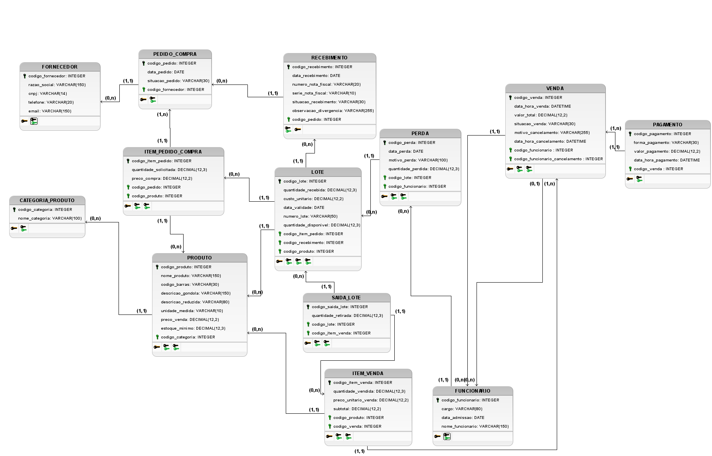

# Entrega 2 — Modelo Lógico, Implementação SQL e Apresentação Final

### Modelagem de um sistema de gestão de informações — Hortifruti União (Tatuapé)

**Relatório Técnico Final — Entrega 2.** Continuamos com o Hortifruti União (Tatuapé), a mesma organização da Entrega 1. Os números de movimento vieram da entrevista; não conferimos porte jurídico nem fiscal. O esqueleto fala em “organização de pequeno porte”, mas o mercado tem cerca de 110 funcionários e um volume alto de vendas. Se o professor pedir, ajustamos essa classificação com ele.

### Integrantes

| Nome completo do aluno | RGM | Usuário do GitHub |
| :---- | :---- | :---- |
| Tarcisio Santos de Oliveira | 47913061 | TarcisioT |
| Gabriela Porfírio da Silva | 48017698 | porfiriogabis |
| Henrique Moura de Oliveira | 47610972 | Bkrusher666 |
| Victor Hugo dos Santos Maciel | 48037630 | vhugosm |
| Guilherme Damasceno dos Santos | 48491683 | damascenogs |

&nbsp;

### 1.1 Revisão do Modelo Conceitual

#### Caracterização da Organização

- **Nome e natureza da organização:** Hortifruti União – Tatuapé, empresa privada com fins lucrativos, do comércio varejista alimentício.

- **Contexto e dimensão operacional:** o mercado abre todos os dias. Os números abaixo são o que o responsável nos passou na conversa; não saíram de relatório do ERP nem de auditoria:

  - **Pessoas:** uns 110 funcionários e 7 caixas.
  - **Vendas:** em média 2.400 transações por dia (cerca de 72.000 no mês), ticket médio de R$ 70 e faturamento perto de R$ 5,04 milhões por mês.
  - **Produtos:** 28 mil SKUs no cadastro, entre ativos e inativos.
  - **Fornecedores:** 650 cadastrados; uns 350 tiveram movimentação nos últimos 90 dias.
  - **Recebimento:** cerca de 1.200 lotes por semana (lote = produto + fornecedor + identificação no recebimento).
  - **Perdas:** cerca de R$ 75 mil por mês (em torno de 1,5% do faturamento), somando vencimento, avaria, quebra e produto estragado.

- **Problemas e necessidades identificados:**

  - **P1 — Controle de validade e rastreabilidade dos lotes:** no VR Software dá para cadastrar validade, mas esse registro não é usado de forma sistemática no dia a dia. Lotes diferentes do mesmo produto compartilham o mesmo código de barras, então esse código, sozinho, não distingue um lote do outro. A organização da gôndola e do estoque também pode dificultar que o que vence primeiro saia antes.

  - **O que o modelo faz com o P1:** cada lote tem código próprio, produto, validade e saldo (`LOTE`). A venda liga a quantidade ao lote em `SAIDA_LOTE`, e o descarte vai para `PERDA`. G01 e G02 mostram o que está para vencer ou já venceu; G03 mostra o custo da perda. **O que o banco sozinho não resolve:** o código de barras continua sendo do produto, não do lote. Sem um jeito de marcar o lote na hora de separar a mercadoria, a rastreabilidade no papel não vira prática no salão. Consulta também não substitui FEFO, bloqueio no caixa nem a organização física.

- **Escopo do sistema:** o banco cobre o que de fato levantamos — não só estoque e também não “toda a administração” do hortifruti. O que ficou de fora está justificado mais abaixo.

  Entram:
  - categorias, produtos, fornecedores e funcionários;
  - pedidos de compra e itens;
  - recebimento e dados da NF de entrada;
  - lotes, validade, saldo, saída por lote e perda;
  - vendas, itens, pagamentos e, em `VENDA`, campos para cancelamento.

  As consultas e a demonstração SQL giram em torno do **P1** (validade e lote). Compra, venda, pagamento e responsável entram para o modelo fazer sentido. FEFO automático, permissão por cargo, baixa automática do saldo e fechamento de caixa **não** têm módulo nesta entrega.

  **O que existe no mercado e o que fizemos com isso:**

  - **Cancelamento de venda:** campos em `VENDA` (`situacao_venda`, `motivo_cancelamento`, `data_hora_cancelamento`, `codigo_funcionario_cancelamento`). O script **não** mostra um `UPDATE` de cancelamento.
  - **Preço e histórico:** o VR já guarda horário e usuário. Aqui só fica o preço atual em `PRODUTO.preco_venda`.
  - **Fechamento de caixa:** o responsável confirmou o processo. Não criamos tabela de fundo, contagem e diferença. Dá para consultar venda e pagamento; não substitui o caixa do ERP.
  - **NF de saída e integração com o VR:** fora do trabalho prático. A obrigação fiscal continua com eles.
  - **Tela de caixa, etiqueta e senha:** fora desta entrega.

  **Processos comuns de varejo que não modelamos porque o levantamento não deu base** (não estamos dizendo que não existem): contas a pagar, escala e ponto.

- **Justificativa da escolha:** é um comércio real, com compra, recebimento, estoque e venda. O Tarcisio conhece um dos responsáveis, e por isso conseguimos a entrevista, a visita e os números. Isso **não** tira a obrigação de comprovar entrevista e visita. O caso serve para a disciplina porque a dificuldade no controle das informações de lote e validade aparece na operação e pode ser trabalhada num banco relacional.

- **Evidências da organização:**

  - [Localização no Google Maps](https://www.google.com/maps/search/?api=1&query=Rua+Filipe+Camar%C3%A3o%2C+67%2C+Tatuap%C3%A9%2C+S%C3%A3o+Paulo)
  - **Perfil comercial no Google:** [Consultar perfil do Hortifruti União no Google](https://share.google/LWFseN2UxnhQwKsNh)
  - **Endereço:** Rua Filipe Camarão, nº 67, Tatuapé, São Paulo, CEP 03065-000
  - **Contato da organização:** perfil comercial público no Google
  - **Responsável entrevistado:** Guilherme Takemoto
  - **Função:** um dos proprietários do Hortifruti União – Tatuapé
  - **Telefone de contato autorizado:** (11) 99317-0906

#### Relato da entrevista

- **Quem:** Guilherme Takemoto, um dos proprietários do Hortifruti União – Tatuapé. Quem entrevistou, visitou e tirou as fotos foi o Tarcisio Santos de Oliveira. Os outros integrantes não foram à entrevista nem à visita.

- **Quando e onde:**
  - Conversa de cerca de uma hora por videochamada (WhatsApp) em **22/09/2026**. Não foi no mercado.
  - Observação no salão e no estoque em **30/09/2026**, Rua Filipe Camarão, 67, Tatuapé.
  - Depois o grupo confirmou com o responsável: pedido por e-mail, NF na entrada, pagamento dividido e fechamento de caixa. **Ainda precisamos conferir a data e o canal dessa conversa no registro original.**

- **O que ele nos disse:** volumes; uso do VR Software; validade existe no sistema, mas seu registro não é usado de forma sistemática; mesmo código de barras para lotes diferentes; pedido por e-mail; entrada com NF; pagamento em dinheiro, débito e crédito (sem Pix), podendo dividir; permissão por cargo; cancelamento de venda já fechada só com gerente ou fiscal; fechamento de caixa no fim do dia, conferindo o dinheiro.

- **O que Tarcisio observou no local:** movimento do salão e do estoque e organização das mercadorias. A visita levantou o risco de não priorizar o que vence primeiro. Ele também registrou as fotos da fachada, do interior e do estoque.

- **Comprovação da visita:** fotos JPG/JPEG em `imagens/evidencias/`.

- **Visita e comprovação da entrevista:** o Tarcisio foi ao Hortifruti União em **30/09/2026** (Rua Filipe Camarão, 67). Esteve no local, observou o salão e o estoque e tirou as fotos da fachada, do interior e do estoque (`imagens/evidencias/`). **Não ficou foto junto com o responsável** — esqueceu de registrar. A conversa longa de levantamento foi por videochamada (WhatsApp) em **22/09/2026**. Combinamos com o professor que a comprovação da entrevista pode ser pelo telefone, sem exigir a foto dos dois no estabelecimento.

**Levantamento completo:** [levantamento/levantamento.md](levantamento/levantamento.md)

**Resumo:** o Hortifruti União usa o VR Software, tem 7 caixas e cerca de 2.400 transações por dia. Produto, fornecedor e preço já estão no ERP. O que falha na prática é o acompanhamento dos lotes e das validades: o código de barras não diferencia os lotes, e o registro da validade não é usado de forma sistemática. Compra vai por e-mail; entrada exige NF. Venda não cadastra cliente. Dá para pagar com mais de uma forma (dinheiro, débito, crédito); Pix não entra. Cancelamento e fechamento de caixa existem, com gerente ou fiscal. Contas a pagar, escala e ponto não foram explicados o bastante para virar tabela. Em relação à Entrega 1, retiramos a entidade CLIENTE (eles não cadastram cliente na venda), deixamos o problema declarado só no P1 e passamos a modelar lote, recebimento, perda e saída por lote.

---

#### Processos de Negócio

Os processos abaixo saíram da entrevista, da visita e, quando estiver escrito, de melhoria que o **grupo** propôs. Processos típicos de hortifruti foram checados com o responsável ou justificados quando ficaram de fora. O uso de IA para listar o que é comum no ramo está na seção 6. **Proposta nossa não é a mesma coisa que o responsável confirmou.**

##### 1. Processo de venda no caixa

O cliente apresenta os produtos no caixa. O funcionário identifica cada produto pelo código de barras e consulta nome e preço.

Para cada item registram-se produto, quantidade e preço unitário praticado. Calcula-se o total e registra-se a forma (ou as formas) de pagamento.

No banco acadêmico: `VENDA` (data/hora, funcionário, valor total, situação), `ITEM_VENDA` (produto, quantidade, preço praticado, subtotal), `PAGAMENTO` e `SAIDA_LOTE` (lotes e quantidades retiradas). O saldo disponível fica em `LOTE`. O script **não demonstra** `UPDATE` automático desse saldo após a venda. Identificação do caixa físico, leitura de código de barras em interface e documento fiscal oficial ficam no sistema do estabelecimento.

**Dados:** identificação da venda, data e horário, funcionário, produtos, quantidades, preços unitários, subtotais, valor total, formas de pagamento e situação da venda.

##### 2. Processo de pedido e recebimento de mercadorias

Pedidos aos fornecedores são feitos por e-mail. Na solução proposta, cada pedido é registrado e vinculado a um fornecedor cadastrado (`PEDIDO_COMPRA`, `ITEM_PEDIDO_COMPRA`: produto, quantidade solicitada, valor unitário previsto).

No recebimento, as mercadorias vêm com nota fiscal e são conferidas (produtos, quantidades, condições, lotes e validades). Divergências ficam em `RECEBIMENTO.observacao_divergencia`. Lotes aceitos entram em `LOTE`. Recebimento parcial e recusa detalhada não foram especificados o bastante na entrevista e não têm fluxo próprio nesta entrega.

**Dados:** pedido, fornecedor (razão social, CNPJ, e-mail), data, produtos, quantidades solicitadas e recebidas, valores unitários, número e série da NF, lote, validade, divergência e situação do recebimento.

##### 3. Processo de controle de estoque, lotes e validade

O estoque considera quantidades por produto e movimentações de entrada, venda e perda. Um produto pode ter vários lotes, cada um com número, validade e quantidade disponível. A data de recebimento está em `RECEBIMENTO.data_recebimento`, não em coluna `data_entrada` de `LOTE`.

Consulta-se estoque por código, nome ou código de barras; identificam-se produtos abaixo do mínimo (`PRODUTO.estoque_minimo`, consulta G04) e lotes próximos do vencimento (G01) ou vencidos (G02). A estratégia FEFO é regra proposta (RN14); a seleção automática do lote **não** está no script. Perdas (`PERDA`) registram lote, quantidade, data, motivo e funcionário; a baixa automática do saldo **não** é executada pelo script.

**Dados:** produto, código de barras, lote, número do lote, data de recebimento, validade, quantidade recebida, quantidade disponível, estoque mínimo, saídas, quantidade perdida, motivo e funcionário.

##### 4. Processo de pagamento

Aceita-se dinheiro, débito e crédito; não se aceita Pix. Uma venda pode ter mais de um pagamento; a soma deve igualar o total (RN15). O banco não tem campo de situação do pagamento; a situação da operação está em `VENDA`. A massa atual tem **um** pagamento; pagamento dividido **não** foi demonstrado no script.

**Dados:** identificação do pagamento, venda, forma, valor, data e horário.

##### 5. Processo de cancelamento

Retirada de item antes de concluir a venda não deve baixar estoque em definitivo. Cancelamento de venda já concluída depende de gerente ou fiscal de caixa (RN10). O banco tem campos para situação, motivo, data/hora e funcionário do cancelamento; o script **não executa** um cancelamento. Devolução ao lote de origem não foi demonstrada.

**Dados:** venda, itens, produtos, lotes, quantidades, motivo, data/hora, funcionário e situação.

##### 6. Processo de alteração de preços e emissão de etiquetas

Alteração de preço: líderes de setor, gerente e proprietários. O ERP já guarda histórico (horário e usuário). O banco acadêmico mantém só o preço atual. Etiquetas e impressão ficam fora da implementação prática.

**Dados consultáveis:** código do produto, código de barras, nome de gôndola e preço atual (`PRODUTO`).

##### 7. Processo de controle de acesso

O ERP aplica permissão por função. `FUNCIONARIO` identifica quem realizou venda ou perda. Não há login, senha, perfil nem auditoria de usuário neste banco. Identificar o funcionário na operação **não prova** que ele tinha permissão.

**Dados (propostos para evolução, não implementados):** usuário, senha protegida, perfil, permissão e log de auditoria.

##### 8. Processo de fechamento de caixa

Ao final do dia, o operador confere o dinheiro físico com o saldo esperado em espécie (fundo + entradas − saídas em dinheiro). Fiscal de caixa ou gerente valida. Cartões não entram na contagem física.

Não há módulo de abertura, fundo, contagem, diferença e validação. O banco guarda vendas e pagamentos para consulta, sem substituir o caixa do ERP.

**Dados (processo real, sem tabelas próprias):** caixa, data, operador, validador, fundo, entradas e saídas em dinheiro, saldo esperado, valor contado, diferença e situação.

##### Processos não incluídos no escopo atual

- **Contas a pagar:** vencimentos, parcelas e situação financeira não foram levantados com segurança.
- **Escala de funcionários:** não detalhada.
- **Jornada e ponto:** não detalhados.

Poderão entrar depois se o responsável confirmar regras e dados. Ficaram de fora por **falta de levantamento**, não porque o grupo diga que esses processos não existem.

Também ficam de fora: cadastro de cliente e fidelidade (o mercado não cadastra cliente na venda) e Pix (não aceito).

##### Fluxogramas

**Fluxograma do processo de venda:**

**Fluxograma do processo de estoque:**

---

#### Requisitos do Sistema

**Sobre o que está implementado:** RFs e RNFs descrevem o sistema que propomos a partir do levantamento. A parte demonstrada até aqui é o banco MySQL, a massa fictícia e as consultas G01–G05 e A01–A05. Alerta, FEFO, permissão, baixa automática de saldo, tela e fiscal continuam como proposta (seção 1.5 e o [Dicionário de Dados](Dicionario_Dados.md)). As limitações do SQL descritas neste texto se referem à cópia usada na conferência; ainda falta alinhá-la com o arquivo final na `main`, como explicado nas seções 1.5 e 1.6.

##### Requisitos Funcionais

- **RF01 — Cadastro de produtos:** cadastrar produto com código identificador único, nome, código de barras, descrição de gôndola, descrição reduzida, categoria, unidade de medida, preço de venda e estoque mínimo (`PRODUTO`).

- **RF02 — Cadastro de categorias:** cadastrar categoria (ex.: frutas, verduras, mercearia, legumes) antes dos produtos que a utilizam (RN16).

- **RF03 — Cadastro de fornecedores:** cadastrar fornecedor com código, razão social, CNPJ, telefone e e-mail (`FORNECEDOR`). RN04 exige CNPJ válido e único e dados obrigatórios; a validação de dígitos do CNPJ não está no DDL.

- **RF04 — Consulta de produtos por fornecedor:** identificar produtos já pedidos a cada fornecedor via `FORNECEDOR`, `PEDIDO_COMPRA` e `ITEM_PEDIDO_COMPRA`. Não há tabela `FORNECEDOR_PRODUTO`; fornecedor sem pedido não tem lista de produtos.

- **RF05 — Pedido de compra:** registrar pedido vinculado a fornecedor cadastrado, com data, situação e itens (`PEDIDO_COMPRA`, `ITEM_PEDIDO_COMPRA`). Pela RN13, um pedido completo tem ao menos um item; a FK sozinha não garante isso.

- **RF06 — Recebimento de mercadorias:** registrar entrada com número da NF, produto, lote, quantidade recebida e validade, vinculado ao pedido, com divergência de conferência (RN02).

- **RF07 — Consulta de estoque:** consultar quantidade disponível por produto e por lote (código, nome ou código de barras) e indicar estoque abaixo do mínimo (RN06, G04).

- **RF08 — Registro de venda:** registrar venda com um ou mais produtos, quantidades, preços praticados, data e horário, situação e funcionário. Sem cadastro de cliente. Sem identificação do caixa físico nesta entrega.

- **RF09 — Valor da venda:** subtotal = quantidade × preço praticado; total = soma dos subtotais. Valores gravados em `ITEM_VENDA.subtotal` e `VENDA.valor_total`. Sem coluna calculada nem trigger nesta entrega.

- **RF10 — Retirada de item antes da conclusão:** requisito de aplicação de caixa; não demonstrado no script.

- **RF11 — Cancelamento de venda:** preservar histórico da venda concluída cancelada (situação, motivo, data/hora, funcionário). Autorização operacional: RN10. Devolução ao estoque: evolução futura. Script atual **não demonstra** cancelamento.

- **RF12 — Pagamento:** registrar pagamentos da venda (`PAGAMENTO`: forma, valor, data/hora). Vários pagamentos por venda (RN15). O SQL usado na conferência não garante que a soma dos pagamentos seja igual ao total da venda.

- **RF13 — Informações fiscais das vendas:** necessidade legal do estabelecimento; **fora da implementação**. Sem campos de NF de saída em `VENDA`. Emissão permanece no sistema fiscal da empresa.

- **RF14 — Registro de saída por lote:** `SAIDA_LOTE` associa item vendido ao lote e à quantidade retirada. FEFO automático e baixa automática do saldo: evolução futura.

- **RF15 — Lotes vencidos e saldo:** consultar validade e quantidade para achar vencidos e saldo insuficiente. Sem bloqueio automático universal de venda.

- **RF16 — Consulta de validade:** listar lotes vencidos e próximos do vencimento, com produto, lote, quantidade e validade.

- **RF17 — Lotes próximos do vencimento:** G01 lista os lotes com saldo positivo e validade no intervalo acadêmico de 7 dias a partir de `2026-10-28`. O script usa data fixa para o teste dar o mesmo resultado sempre; em produção o período seria configurável. Sem notificação automática.

- **RF18 — Registro de perdas:** `PERDA` com lote, quantidade, data, motivo e funcionário (RN07, RN17). Baixa automática do saldo: não demonstrada no script.

- **RF19 — Alteração de preços:** processo do ERP (histórico e login). Neste banco: apenas preço atual.

- **RF20 — Dados para etiquetas:** consultar código, código de barras, nome de gôndola e preço. Impressão fora do escopo.

- **RF21 — Cadastro de funcionários:** código, nome, cargo e data de admissão, para associar a vendas e perdas. Sem login/senha neste banco.

- **RF22 — Fechamento de caixa:** processo real do Hortifruti União; **sem módulo** nesta entrega.

##### Requisitos Não Funcionais

- **RNF01 — Desempenho:** estrutura com PK/FK para consultas de produto, venda, lote e estoque. Sem índices extras (código de barras, validade, situação) e sem teste de concorrência dos 7 caixas. Meta de resposta &lt; 3 s **não comprovada**.

- **RNF02 — Disponibilidade:** testes em MySQL de laboratório. Sem alta disponibilidade nem caixa offline.

- **RNF03 — Segurança:** integridade por PK/FK; acesso limitado ao ambiente MySQL. Sem tela de login de funcionário.

- **RNF04 — Usabilidade dos dados:** nomes padronizados e dicionário de dados. Sem avaliação de interface gráfica.

- **RNF05 — Recuperação:** o script recria estrutura e massa fictícia; isso **não** substitui backup. Sem teste documentado de dump/restore.

- **RNF06 — Integridade das movimentações:** auditorias A01–A04 na massa fictícia. Sem transação completa de venda com baixa automática de estoque.

- **RNF07 — Rastreabilidade:** caminho recebimento → lote → saída por item de venda. As perdas também ficam ligadas ao lote. Sem módulo de auditoria de usuários nem histórico de preços.

- **RNF08 — Conformidade (LGPD e fiscal):** testes só com dados fictícios. Fiscal de saída permanece no sistema da empresa.

- **RNF09 — Integração:** dados centralizados no modelo relacional. Sem integração automática com o VR Software.

**Requisitos típicos não incluídos:** cadastro de cliente e fidelidade (não usados na venda); Pix (não aceito); contas a pagar, escala e ponto (levantamento insuficiente). Ver seção 6 (IA para requisitos típicos).

---

#### Regras de Negócio

**De onde veio cada regra:** **[Entrevista]** = o responsável falou. **[Proposta]** = o grupo montou, em parte com IA (seção 6), e **ainda não passou regra por regra com ele**.

O texto da regra fala do negócio ou do sistema inteiro. O que o MySQL realmente impede está na seção 1.5 e no dicionário.

**Regras operacionais**

- **RN01 — Bloqueio de venda de produtos vencidos [Entrevista / mecanismo a confirmar]:** o responsável falou de um bloqueio de produto vencido no ERP. Como lotes diferentes usam o mesmo código de barras e o registro da validade não é usado de forma sistemática, **não dá para afirmar que o ERP trava um lote específico no caixa**. No nosso banco, G02 lista vencido com saldo, mas não existe bloqueio na hora de vender. Precisamos confirmar com ele até onde vai o bloqueio de hoje.

- **RN02 — Entrada de estoque com nota fiscal [Entrevista]:** segundo o responsável, a mercadoria deve chegar acompanhada de NF, com produtos, lotes, quantidades e validades. `RECEBIMENTO` tem campos para número e série da NF, mas o SQL usado na conferência ainda permite deixá-los vazios. A obrigação existe no processo; o que falta é o banco exigir o preenchimento desses campos (ver 1.5).

- **RN03 — Pedido só a fornecedor cadastrado [Proposta]:** pedido de compra somente para fornecedor já cadastrado.

- **RN04 — Fornecedor com CNPJ válido [Proposta]:** cadastro com CNPJ válido e único, razão social, telefone e e-mail. No SQL que estávamos olhando, não há `NOT NULL`, `UNIQUE` nem checagem dos dígitos do CNPJ; os CNPJs da massa são fictícios.

- **RN05 — Cancelamento de venda [Proposta]:** venda concluída pode ser cancelada com autorização (RN10), preservando o registro (situação, motivo, data/hora, funcionário). Não demonstrado no script.

- **RN06 — Estoque mínimo [Entrevista]:** cada produto tem mínimo (comprador, com apoio do ERP e gerência). G04 lista produtos abaixo do mínimo. Sem alerta automático.

- **RN07 — Perdas por vencimento [Proposta]:** lote vencido não deve ser vendido; perda registrada com lote, quantidade, data, motivo e funcionário, com baixa de saldo. A massa tem um exemplo; o script não baixa o saldo sozinho.

- **RN08 — Obrigatoriedade fiscal [Entrevista]:** emissão e autorização fiscal continuam no sistema da organização. Fora desta implementação.

- **RN09 — Lotes próximos do vencimento [Proposta]:** consulta G01 com intervalo de 7 dias e data fixa `2026-10-28`. Prazo acadêmico, não confirmado pelo responsável. Sem notificação.

- **RN10 — Permissões por função [Entrevista]:** preço: líder de setor, gerente, proprietários. Cancelamento e fechamento de caixa: gerente ou fiscal. Financeiro: administração e gestão. Sem autenticação neste banco.

- **RN11 — Produtos a granel [Proposta]:** quantidade em quilos e preço por quilo. Balanças devem atender ao Inmetro (exigência operacional, não modelada em tabela).

- **RN12 — LGPD [Proposta]:** proteger dados de funcionários e contatos de fornecedores. Testes só fictícios. Sem CPF e sem autenticação neste banco.

- **RN13 — Pedido de compra com itens [Proposta]:** todo pedido tem ao menos um item; cada item é de um pedido.

- **RN14 — Saída por lote e FEFO [Proposta]:** item vendido associado a um ou mais lotes (`SAIDA_LOTE`). FEFO prioriza o lote válido que vence primeiro. Rastreio demonstrado; FEFO automático não implementado.

- **RN15 — Formas de pagamento [Entrevista]:** dinheiro, débito e crédito; sem Pix. Pagamento pode ser dividido; a soma deve igualar o total. Massa atual: um pagamento.

- **RN16 — Categoria do produto [Proposta]:** todo produto pertence a uma categoria já cadastrada; uma categoria pode ter vários produtos.

- **RN17 — Perdas por outros motivos [Proposta]:** dano, deterioração etc. com lote, quantidade, data, motivo e funcionário, atualizando o saldo.

- **RN18 — Quantidade vendida [Proposta]:** retiradas não podem gerar saldo negativo nem usar lote vencido. As auditorias conferem alguns pontos da massa; o script não bloqueia todas as operações futuras.

- **RN19 — Baixa de estoque e rastreabilidade [Entrevista / Proposta]:** o ERP atual baixa estoque na venda concluída. A proposta acadêmica associa a quantidade ao lote via `SAIDA_LOTE`. Atualização consistente do saldo depende da aplicação ou de procedimentos ainda não automatizados.

- **RN20 — Preservação dos registros [Proposta]:** vendas canceladas, pagamentos e perdas permanecem no banco. Sem histórico completo de todas as alterações.

- **RN21 — Fechamento de caixa [Entrevista]:** conferência de dinheiro físico; validação por fiscal ou gerente. Sem módulo nesta entrega.

- **RN22 — Consistência pedido, recebimento e lote [Proposta]:** lote associado a recebimento e a item de pedido do mesmo pedido; produto do lote = produto do item. A auditoria A02 compara essas referências nos registros vinculados da massa; FKs isoladas não garantem sozinhas todas as condições.

**Regras comuns não incluídas:** cliente/fidelidade (não há cadastro na venda); Pix (não aceito); normas sanitárias detalhadas, contas a pagar e escala (não ligadas a P1 e sem levantamento suficiente).

---

#### Delimitação do Escopo da Implementação

Prioridade: **P1 — validade e rastreabilidade de lotes.** Também entram os dados essenciais de cadastro, compra, recebimento e venda.

Depois de falar de novo com o responsável, o grupo deixou o antigo “segundo problema” (histórico de preço e acesso) como coisa do ERP, não como P2.

**Incluído na implementação prática:** cadastros; pedidos e itens; recebimento e NF de entrada; lotes, validade, saldos e perdas; vendas, itens, pagamentos e saídas por lote; consultas G01–G05 e auditorias A01–A05.

**Fora da implementação prática:** NF de saída junto ao Fisco; impressão de etiquetas; integração com VR Software; caixa offline; interfaces completas; modelos preditivos de IA; FEFO automático; permissão por perfil; baixa automática de estoque em todas as operações.

#### DER Conceitual Revisado

**Software utilizado:** brModelo 3.2.0. Notação de entidades, atributos, relacionamentos e cardinalidades (mín, máx). **Chaves estrangeiras não aparecem no DER conceitual**; estão no modelo lógico (seção 2) e no dicionário.

**Situação:** 13 entidades e 17 relacionamentos; exportado em PNG em `diagramas/der_conceitual.png`.

**Resumo das entidades e relacionamentos:**

| Entidade 1 | Relacionamento | Entidade 2 | Cardinalidade |
|---|---|---|---|
| PRODUTO | POSSUI | LOTE | (0,N) / (1,1) |
| CATEGORIA_PRODUTO | CLASSIFICA | PRODUTO | (0,N) / (1,1) |
| FORNECEDOR | RECEBE | PEDIDO_COMPRA | (0,N) / (1,1) |
| PEDIDO_COMPRA | CONTÉM | ITEM_PEDIDO_COMPRA | (1,N) / (1,1) |
| PRODUTO | APARECE_EM | ITEM_PEDIDO_COMPRA | (0,N) / (1,1) |
| FUNCIONARIO | REALIZA | VENDA | (0,N) / (1,1) |
| FUNCIONARIO | CANCELA | VENDA | (0,N) / (0,1) |
| VENDA | CONTÉM | ITEM_VENDA | (1,N) / (1,1) |
| PRODUTO | APARECE | ITEM_VENDA | (0,N) / (1,1) |
| VENDA | POSSUI | PAGAMENTO | (1,N) / (1,1) |
| LOTE | APRESENTA | PERDA | (0,N) / (1,1) |
| FUNCIONARIO | REGISTRA | PERDA | (0,N) / (1,1) |
| ITEM_VENDA | UTILIZA | SAIDA_LOTE | (1,N) / (1,1) |
| LOTE | ORIGINA | SAIDA_LOTE | (0,N) / (1,1) |
| PEDIDO_COMPRA | GERA | RECEBIMENTO | (0,N) / (1,1) |
| RECEBIMENTO | REGISTRA | LOTE | (0,N) / (1,1) |
| ITEM_PEDIDO_COMPRA | ORIGINA | LOTE | (0,N) / (1,1) |

*Cardinalidades na ordem das entidades de cada linha. A participação mínima é regra do modelo conceitual, não garantia do SQL: no script que conferimos, as FKs aceitam `NULL` (até nas relações que no desenho são obrigatórias). A FK no item, por exemplo, não impede uma venda sem nenhum item. Ver seção 1.5.*

**Caso A — mesma organização da Entrega 1. Apontamentos da correção:**

| Apontamento da correção da E1 | O que mudou no trabalho | Por quê |
|---|---|---|
| Processos de negócio incompletos | Detalhados vendas, compras, recebimento, estoque, pagamentos, cancelamentos, preços, acesso e fechamento de caixa | Mostrar o mercado e o que o banco cobre |
| Fluxogramas só como anexo | Imagens no README, na seção de processos | O professor vê o fluxo sem abrir outro arquivo |
| Regras de negócio incompletas | Incluídas validade, estoque mínimo, FEFO, perdas, pagamentos, permissões, granel e LGPD | Coerência com os processos |
| Inconsistência no cadastro de clientes | Entidade CLIENTE retirada | O mercado não cadastra cliente para registrar a venda |
| Cardinalidades e relacionamentos incorretos | Revisadas; criados itens de compra/venda, lote, pagamento e perda | Representar N:N com dados de quantidade e preço |
| Dicionário incompleto | `Dicionario_Dados.md` com 13 tabelas e 74 colunas | Turma GTI: Markdown separado do README |
| Justificativas técnicas superficiais | Seções 1.2 a 1.5 | Demonstrar conversão, chaves, normalização e restrições |

### 1.2 Conversão do Modelo Conceitual para o Modelo Lógico

Passamos as 13 entidades para 13 tabelas no MySQL 8.0: `PRODUTO`, `CATEGORIA_PRODUTO`, `FORNECEDOR`, `PEDIDO_COMPRA`, `ITEM_PEDIDO_COMPRA`, `RECEBIMENTO`, `LOTE`, `FUNCIONARIO`, `VENDA`, `ITEM_VENDA`, `PAGAMENTO`, `PERDA` e `SAIDA_LOTE`. São 13 PKs e 17 FKs.

Os atributos viraram colunas (`codigo_produto`, `nome_produto`, `preco_venda`, `unidade_medida` etc.). Identificador virou PK; referência virou FK.

No 1:N a FK ficou no lado N (exemplo: `LOTE.codigo_produto` aponta para `PRODUTO`). Onde era N:N, criamos tabela no meio:

- `ITEM_VENDA`: venda × produto (quantidade, preço praticado, subtotal);
- `ITEM_PEDIDO_COMPRA`: pedido × produto (quantidade, preço de compra);
- `SAIDA_LOTE`: item vendido × lote (quantidade retirada).

Não fizemos tabela `FORNECEDOR_PRODUTO`. A lista de produtos por fornecedor sai do histórico de pedidos (RF04).

Não usamos generalização/especialização: no escopo não apareceu hierarquia do tipo pessoa física/jurídica.

### 1.3 Definição de Chaves Primárias e Estrangeiras

| Tabela | Chave primária (PK) | Chaves estrangeiras (FK) |
|---|---|---|
| FORNECEDOR | `codigo_fornecedor` | Não possui |
| CATEGORIA_PRODUTO | `codigo_categoria` | Não possui |
| FUNCIONARIO | `codigo_funcionario` | Não possui |
| PRODUTO | `codigo_produto` | `codigo_categoria` → CATEGORIA_PRODUTO |
| PEDIDO_COMPRA | `codigo_pedido` | `codigo_fornecedor` → FORNECEDOR |
| ITEM_PEDIDO_COMPRA | `codigo_item_pedido` | `codigo_pedido` → PEDIDO_COMPRA; `codigo_produto` → PRODUTO |
| RECEBIMENTO | `codigo_recebimento` | `codigo_pedido` → PEDIDO_COMPRA |
| LOTE | `codigo_lote` | `codigo_produto` → PRODUTO; `codigo_item_pedido` → ITEM_PEDIDO_COMPRA; `codigo_recebimento` → RECEBIMENTO |
| PERDA | `codigo_perda` | `codigo_lote` → LOTE; `codigo_funcionario` → FUNCIONARIO |
| VENDA | `codigo_venda` | `codigo_funcionario` → FUNCIONARIO; `codigo_funcionario_cancelamento` → FUNCIONARIO |
| ITEM_VENDA | `codigo_item_venda` | `codigo_venda` → VENDA; `codigo_produto` → PRODUTO |
| PAGAMENTO | `codigo_pagamento` | `codigo_venda` → VENDA |
| SAIDA_LOTE | `codigo_saida_lote` | `codigo_lote` → LOTE; `codigo_item_venda` → ITEM_VENDA |

**Cardinalidade conceitual × SQL:** as mínimas (1,1) e (1,N) são regra de negócio. Na cópia usada na conferência (`script(2).sql`), as 17 FKs **aceitam NULL**. A FK, sozinha, também não exige que cada pedido ou venda tenha pelo menos um item, nem que cada venda tenha um pagamento. Quando a FK está preenchida, ela impede uma referência a registro inexistente (teste A05).

**Observação:** o modelo implementado não possui uma tabela associativa direta entre FORNECEDOR e PRODUTO. A identificação dos produtos solicitados a cada fornecedor é realizada por meio das tabelas PEDIDO_COMPRA e ITEM_PEDIDO_COMPRA. Essa simplificação foi adotada para manter o foco nos processos de compra e recebimento incluídos no escopo acadêmico. O DER conceitual foi revisado e exportado, e sua representação contempla os relacionamentos definidos para as 13 entidades do projeto. As diferenças entre a obrigatoriedade indicada pelas cardinalidades conceituais e as restrições efetivamente aplicadas no MySQL estão documentadas como limitações da implementação.

### 1.4 Processo de Normalização (1FN, 2FN e 3FN)

- **1FN — Primeira Forma Normal:** cada coluna tem um valor só. Os produtos de uma venda e de um pedido não vão numa lista dentro de `VENDA` ou `PEDIDO_COMPRA`; são linhas de `ITEM_VENDA` e `ITEM_PEDIDO_COMPRA`. No pagamento dividido, cada pagamento fica em uma linha de `PAGAMENTO`.

- **2FN — Segunda Forma Normal:** as PKs são simples, então não há dependência parcial **em relação a essas PKs**. Quantidade e preço de compra dependem de `codigo_item_pedido`; nome do produto e dados do fornecedor ficam nos cadastros. **PK simples sozinha não encerra a análise da 2FN**: também precisamos considerar outras combinações de atributos que possam identificar um item, as chamadas chaves candidatas.

- **3FN — Terceira Forma Normal:** `PEDIDO_COMPRA` guarda `codigo_fornecedor`; razão social, telefone e CNPJ ficam em `FORNECEDOR`. `PRODUTO` guarda `codigo_categoria`; o nome da categoria fica em `CATEGORIA_PRODUTO`. Assim não repetimos descrição em cada movimento.

- **O que ainda é redundante e precisa de cuidado:**
  - `LOTE.codigo_produto` repete o produto que já dá para achar pelo item do pedido. A auditoria A02 compara os dois; não há FK composta. Se alguém atualizar um lado e esquecer o outro, os dados divergem — por isso **não dizemos que o esquema está 3FN sem ressalva**.
  - `ITEM_VENDA.subtotal`, `VENDA.valor_total` e `LOTE.quantidade_disponivel` são valores gravados para facilitar consulta. Sem um mecanismo que os mantenha consistentes com as movimentações, podem surgir diferenças entre o saldo, os itens e o total da venda.

Em resumo: separamos as listas (1FN) e os dados dos itens dos cadastros. Ter PK própria ajuda a identificar cada item, mas não basta para provar a 2FN. Também evitamos repetir dados de fornecedor e categoria em cada movimento. **Não fechamos 3FN em tudo.** A redundância do lote ainda precisa ser resolvida ou justificada no dicionário, mostrando no SQL como os dados ficam consistentes. Conferir os valores por uma consulta, por si só, não elimina essa redundância.

### 1.5 Justificativas Técnicas das Decisões

**Chaves primárias:** cada uma das 13 tabelas tem identificador simples (`codigo_produto`, `codigo_lote`, `codigo_venda` etc.). Itens de compra/venda e saídas por lote também têm PK própria, para individualizar a linha e rastrear.

**Chaves estrangeiras:** 17 FKs no SQL que analisamos, inclusive `PEDIDO_COMPRA.codigo_fornecedor` → `FORNECEDOR` (RN03), `LOTE.codigo_item_pedido` → `ITEM_PEDIDO_COMPRA` (RN22) e `SAIDA_LOTE.codigo_lote`/`codigo_item_venda` → `LOTE`/`ITEM_VENDA` (RN14). Funcionário da venda e funcionário do cancelamento são duas FKs diferentes de `VENDA` para `FUNCIONARIO`.

**O que está na cópia usada na conferência (`script(2).sql`):**

Esse foi o nome da cópia usada na revisão. O arquivo de entrega é `docs/script.sql`. Os pontos abaixo se referem a essa cópia; não são uma nova verificação do arquivo publicado na `main`.

| Regra SQL | O que garante | Limitação |
|---|---|---|
| 13 chaves primárias (`PRIMARY KEY`) | Identificação única pela PK | Não torna obrigatório o resto dos campos |
| 17 FKs, com `ON DELETE RESTRICT` | Impedem referência *preenchida* a registro inexistente; travam exclusão de quem ainda é usado | As 17 FKs permitem `NULL` |
| Tipos `INT`, `VARCHAR`, `DECIMAL`, `DATE`, `DATETIME` | Cabem no conteúdo | O tipo não impede valor negativo nem fecha regra de negócio |

**Restrições previstas que ainda não aparecem nessa cópia:**

| Restrição necessária | Exemplo de implementação | Requisito/regra |
|---|---|---|
| Obrigatoriedade de fornecedor e categoria | `PEDIDO_COMPRA.codigo_fornecedor NOT NULL`, `PRODUTO.codigo_categoria NOT NULL` | RN03, RN16 |
| Obrigatoriedade dos dados essenciais | `NOT NULL` em FKs e atributos essenciais de item, recebimento, lote, venda e pagamento; deixar nulo só o que for mesmo opcional | RN02, RN13, RN14, RN22 |
| Unicidade de identificadores naturais | `UNIQUE` em `FORNECEDOR.cnpj` e `PRODUTO.codigo_barras` (reavaliar política para produtos de peso variável) | RN04, RF01 |
| Positividade e domínio de valores | `CHECK (quantidade_vendida > 0)`, checagens de preço, perda e saldo, e domínio de `forma_pagamento` | RN15, RN18 |
| Lote compatível com pedido, recebimento e produto | Validação na transação ou integridade composta bem desenhada | RN22 |
| Pedido/venda com itens e pagamentos correspondentes | Validação na transação ou procedimento de fechamento | RN13, RN15 |
| Venda com saídas por lote e saldo coerente | Procedimento atômico, validade e saldo, eventual `SELECT ... FOR UPDATE` | RN01, RN14, RN18, RN19 |

**Decisões de arquitetura:** MySQL 8.0 e dados separados em cadastro, movimento e lote. `SAIDA_LOTE` existe para dizer de qual lote saiu a quantidade vendida; o ERP deles continua com a parte fiscal. Este banco acadêmico não tem login por cargo, FEFO automático, cancelamento completo, fechamento de caixa nem baixa automática de todo saldo.

O `docs/script.sql` e o `Dicionario_Dados.md` precisam descrever **a mesma estrutura**: mesmas tabelas, colunas, nome do banco e restrições. Não adianta prometer `NOT NULL`/`UNIQUE`/`CHECK` só no README.

### 1.6 Proposta de Arquitetura Analítica para BI e IA

**Informações estratégicas que podem ser extraídas dos dados:** O banco de dados proposto permitirá acompanhar o volume de vendas, os produtos mais vendidos, as perdas por vencimento, os lotes próximos da validade, os níveis de estoque e os pagamentos por forma de recebimento. Essas informações poderão ajudar o Hortifruti União a identificar desperdícios e planejar melhor suas compras.

| Indicador | Como calcular | Período | Consulta SQL |
|---|---|---|---|
| Lotes próximos do vencimento | Listagem (e contagem das linhas) dos lotes com saldo positivo e validade entre a data de referência e os 7 dias seguintes | Diário | G01 |
| Lotes vencidos com saldo | Listagem dos lotes cuja validade já passou e que ainda possuem quantidade disponível | Diário | G02 |
| Valor financeiro das perdas | Soma da quantidade perdida multiplicada pelo custo unitário de cada lote | Conforme os registros de perda da massa; filtro por período não demonstrado | G03 |
| Produtos abaixo do estoque mínimo | Comparação entre o estoque mínimo cadastrado e a soma das quantidades disponíveis por produto | Diário | G04 |
| Faturamento por período | Soma dos pagamentos associados às vendas concluídas, agrupada pela data da venda | Diário | G05 |
| Recebimento por forma de pagamento | Soma dos pagamentos das vendas concluídas, agrupada por forma | Diário | G06 |

**Resultados das consultas gerenciais — massa do `docs/script.sql`, data de referência 28/10/2026**

| Consulta | Resultado esperado | Observação |
|---|---|---|
| G01 | 3 linhas: Maçã (MAC-001), Banana prata (BAN-001) e Tomate (TOM-001) | Lista os lotes; o indicador de quantidade é a contagem dessas linhas |
| G02 | 1 linha: Alface crespa (ALF-001), saldo 30,000 | Lote propositalmente vencido com saldo, para testar o alerta |
| G03 | 1 registro de perda, R$ 20,00 (10,000 × R$ 2,00, Alface crespa) | O custo de R$ 2,00 do lote ainda diverge do preço de compra de R$ 1,50 no pedido |
| G04 | 2 linhas: Arroz 5 kg (5,000 / mínimo 10,000) e Cenoura (0,000 / mínimo 10,000) | A soma inclui lote vencido. Se tirar a alface, passaria de 2 para 3 produtos abaixo do mínimo |
| G05 | R$ 24,48 em uma venda concluída em 28/10/2026 | Dois pagamentos (dinheiro R$ 10,00 + débito R$ 14,48). Bate com o total dessa venda fictícia |
| G06 | Dinheiro R$ 10,00 e Débito R$ 14,48 | Só aparece nesta massa; crédito ainda não foi demonstrado |

**Resultados das auditorias SQL — Validação em 28/10/2026**

Após a reexecução do script corrigido, as auditorias A01 a A04 foram repetidas e retornaram `Empty set` nos cenários analisados. O teste A05 foi executado pelo script e apresentou a mensagem de confirmação de que a chave estrangeira rejeitou a referência a um funcionário inexistente; em teste direto anterior, o MySQL havia exibido o erro `1452 (23000)`.

| Auditoria | Verificação realizada | Resultado obtido |
|---|---|---|
| A01 | Verificação de lotes sem referência válida a um produto | Nenhuma inconsistência encontrada (`Empty set`) |
| A02 | Consistência entre produto do lote, item de pedido e recebimento | Nenhuma inconsistência encontrada (`Empty set`) |
| A03 | Correspondência entre o produto vendido e o lote utilizado | Nenhuma inconsistência encontrada (`Empty set`) |
| A04 | Comparação entre a quantidade vendida e a soma das quantidades retiradas dos lotes | Nenhuma inconsistência encontrada (`Empty set`) |
| A05 | Teste de inserção de uma venda vinculada a funcionário inexistente | Inserção com funcionário inexistente rejeitada pela chave estrangeira; o script apresentou mensagem de confirmação da rejeição (erro `1452 (23000)` observado também em teste direto) |

**Conclusão das auditorias:** os resultados indicam que os registros fictícios analisados não apresentaram as inconsistências pesquisadas nas auditorias A01 a A04. O teste A05 demonstrou que a restrição de chave estrangeira impede a referência a um funcionário inexistente. Essas verificações não garantem que todas as regras de negócio estejam automatizadas para operações futuras.

**Observação:** os valores apresentados correspondem exclusivamente aos dados fictícios utilizados na demonstração acadêmica e não representam indicadores reais do Hortifruti União. Os resultados das consultas de validade foram obtidos utilizando a data fixa `DATE('2026-10-28')`, definida como referência para os testes acadêmicos. Dessa forma, os resultados apresentados correspondem ao cenário demonstrado nessa data e não se atualizam automaticamente conforme o dia em que o script é executado.

**Limitação adicional do indicador G04:** a consulta demonstrativa soma os saldos registrados por produto sem excluir automaticamente os lotes vencidos. Portanto, seus resultados devem ser interpretados como uma verificação sobre os saldos cadastrados, não como medida exclusiva de estoque próprio para venda.

**Potencial dos dados para BI:** Os dados poderão ser utilizados para construir painéis com gráficos de vendas, evolução das perdas, produtos mais vendidos e situação dos estoques. O gerente poderá consultar esses indicadores para acompanhar o desempenho do mercado e identificar produtos que precisam de maior atenção.

**Aplicações analíticas e de IA:** Futuramente, técnicas de inteligência artificial poderão ser utilizadas para prever a demanda de produtos, identificar mercadorias com maior risco de vencimento e sugerir quantidades de reposição. Essas análises dependerão da existência de dados históricos suficientes e de registros confiáveis de vendas, estoque e perdas.

**Rastreabilidade:**

| Problema ou indicador | Tabelas envolvidas | Consulta SQL testada |
|---|---|---|
| P1 — Lotes próximos do vencimento | PRODUTO, LOTE | G01 — Lotes próximos do vencimento |
| P1 — Lotes vencidos com saldo | PRODUTO, LOTE | G02 — Lotes vencidos |
| P1 — Valor financeiro das perdas | PERDA, LOTE, PRODUTO | G03 — Valor financeiro das perdas |
| Produtos abaixo do estoque mínimo | PRODUTO, LOTE | G04 — Estoque abaixo do mínimo |
| Faturamento por período | VENDA, PAGAMENTO | G05 — Faturamento por período |

*As consultas gerenciais G01 a G05 foram executadas e verificadas no MySQL 8.0, utilizando dados fictícios do Hortifruti União. Elas permitem identificar lotes próximos do vencimento, lotes vencidos, valores financeiros de perdas, produtos abaixo do estoque mínimo e faturamento por período. Também foram realizadas consultas de auditoria para verificar a consistência dos relacionamentos e das movimentações registradas. Os resultados demonstram as funcionalidades testadas, sem representar dados reais ou garantir a automatização completa de todas as regras de negócio propostas.*

---

## 2. Modelo Lógico Relacional

**Software utilizado:** brModelo 3.2.0.

O modelo lógico relacional do Hortifruti União foi desenvolvido no brModelo a partir do DER conceitual revisado. Ele contém **13 tabelas**, com atributos, tipos de dados, chaves primárias, chaves estrangeiras e relacionamentos.

A estrutura foi implementada no MySQL 8.0, onde foram verificadas **17 restrições de chave estrangeira**. Também foram realizados testes com dados fictícios, consultas gerenciais e verificações de integridade referencial.

As limitações relacionadas à seleção automática de lotes pelo método FEFO, ao controle de permissões, à atualização dos saldos de estoque e às demais validações das regras de negócio estão documentadas na seção 1.5 e no Dicionário de Dados. As chaves estrangeiras, isoladamente, não garantem a execução integral dessas regras.

**Situação dos arquivos do modelo lógico:** o modelo lógico relacional foi elaborado e revisado no brModelo 3.2.0, contemplando as 13 tabelas do projeto. As imagens do DER conceitual e do modelo lógico foram enviadas à pasta `diagramas/` do repositório GitHub. O arquivo `Dicionario_Dados.md` foi concluído e revisado, documentando as 74 colunas e seus relacionamentos. O script `docs/script.sql` foi executado no MySQL 8.0, utilizando a base independente `hortifruti_uniao_entrega2`. Foram confirmadas as 13 tabelas, as 17 chaves estrangeiras e os 51 registros fictícios, além da execução das consultas gerenciais G01 a G05 e dos testes de auditoria A01 a A05. As verificações demonstram os cenários testados, sem garantir a automatização integral de todas as regras de negócio.

---

## 3. Script SQL Completo

**SGBD escolhido:** MySQL 8.0.

**Arquivo de entrega:** `docs/script.sql`.

O banco de dados do Hortifruti União foi implementado em ambiente de testes MySQL, com 13 tabelas e 17 chaves estrangeiras, utilizando dados fictícios.

O script contém comandos `CREATE DATABASE`, `CREATE TABLE`, `INSERT`, `SELECT` e consultas com `JOIN`, além de operações demonstrativas `UPDATE` em PRODUTO e `DELETE` em PAGAMENTO executadas dentro de uma transação revertida (`ROLLBACK`). Não há demonstração de `UPDATE` em LOTE nem de cancelamento de venda. Também foram incluídas cinco consultas gerenciais (G01 a G05), quatro auditorias (A01 a A04) e um teste de integridade referencial (A05) com tratamento do erro por procedimento SQL.

Os testes demonstraram consultas sobre lotes próximos do vencimento, lotes vencidos, valor financeiro das perdas, estoque mínimo e faturamento por período.

**Situação da implementação SQL:** o arquivo `docs/script.sql` foi consolidado e executado no MySQL 8.0, utilizando o banco de demonstração independente `hortifruti_uniao_entrega2`. A execução permitiu criar as 13 tabelas, confirmar as 17 chaves estrangeiras e inserir os 51 registros fictícios. As consultas gerenciais G01 a G05 foram executadas e apresentaram resultados compatíveis com os cenários de demonstração. As auditorias A01 a A04 não identificaram inconsistências nos registros analisados, e o teste A05 confirmou que uma chave estrangeira impede o registro de uma venda associada a um funcionário inexistente. Esses resultados validam os cenários testados, sem representar uma garantia de implementação integral de todas as regras de negócio.

**Limitações:** a escolha automática do lote pelo método FEFO, a autorização por perfil de funcionário e todas as validações transacionais de estoque não foram implementadas integralmente. Essas funcionalidades permanecem identificadas como limitações ou melhorias futuras.

**Revalidação da versão corrigida:** o script atualizado foi executado novamente em banco de testes em 28/10/2026. Foram confirmados 13 tabelas, 17 chaves estrangeiras, 51 registros, o saldo de 69,000 do lote TOM-001, os resultados G01 a G05 e as auditorias A01 a A05. As consultas de auditoria verificam os cenários fictícios apresentados e não asseguram a automatização de todas as regras de negócio.

---

## 4. Massa de Dados

**Arquivo de entrega:** `docs/script.sql`. A massa de dados fictícia foi incluída no mesmo script de criação e testes do banco de dados, por meio de comandos `INSERT`. O arquivo consolidado foi executado no MySQL 8.0, utilizando o banco independente `hortifruti_uniao_entrega2`. A execução confirmou a criação das 13 tabelas, das 17 chaves estrangeiras e a inserção dos 51 registros fictícios. As consultas gerenciais G01 a G05 e os testes de auditoria A01 a A05 também foram executados e verificados, considerando os cenários demonstrados.

A massa de dados foi preparada para representar situações de compras, recebimento de mercadorias, controle de validade, perdas, vendas e pagamentos do Hortifruti União. Todos os registros utilizados nos testes são fictícios e foram criados exclusivamente para fins acadêmicos.

**Dados cadastrados e testados no MySQL:**

| Tipo de registro | Quantidade |
|---|---:|
| Categorias de produtos | 4 |
| Fornecedores | 4 |
| Funcionários | 5 |
| Produtos | 8 |
| Pedidos de compra | 4 |
| Itens de pedido de compra | 8 |
| Recebimentos | 3 |
| Lotes de produtos | 8 |
| Perdas registradas | 1 |
| Vendas | 1 |
| Itens de venda | 2 |
| Pagamentos | 1 |
| Saídas de lote | 2 |
| **Total** | **51** |

**Variedade dos dados:** foram incluídos produtos de diferentes categorias, pedidos recebidos e pendentes, dois lotes de banana com validades distintas, lotes próximos do vencimento, um lote vencido, uma perda por vencimento, uma venda com dois produtos, um pagamento e saídas de estoque vinculadas aos lotes de origem.

**Testes realizados:** a massa de dados foi utilizada para executar as consultas gerenciais G01 a G05 e as consultas de auditoria A01 a A04. Também foi realizado um teste de integridade referencial, no qual o MySQL rejeitou uma venda associada a um funcionário inexistente.

**Limitação da amostra:** os 51 registros representam uma massa de dados pequena e controlada para demonstrar os relacionamentos e as operações básicas. Eles não reproduzem o volume real de movimentações do Hortifruti União, nem comprovam desempenho em ambiente de produção.

---

## 5. Repositório GitHub

O repositório GitHub do projeto Hortifruti União reúne a documentação técnica da Entrega 2, incluindo o relatório README, o Dicionário de Dados, os diagramas conceitual e lógico e o script SQL utilizado nos testes. O projeto está organizado na branch `main`, permitindo o acesso aos arquivos e o acompanhamento das contribuições dos integrantes por meio do histórico de commits. A apresentação final permanece em preparação.

**Organização dos arquivos do projeto:**

| Arquivo ou pasta | Conteúdo |
|---|---|
| `README.md` | Relatório técnico da Entrega 2 |
| `Dicionario_Dados.md` | Definição das tabelas, colunas, tipos de dados, chaves e restrições |
| `diagramas/` | DER conceitual revisado e modelo lógico relacional |
| `imagens/evidencias/` | Fotografias e outras evidências do levantamento |
| `docs/script.sql` | Script único com criação das 13 tabelas, inserção dos dados fictícios, operações SQL, consultas gerenciais e testes de auditoria |
| `apresentacao/` | Slides da apresentação final |
| `levantamento/levantamento.md` | Levantamento de informações, entrevista e processos do Hortifruti União |
| `fluxograma_vendas.png` | Fluxograma do processo de venda |
| `fluxograma_estoque.png` | Fluxograma do processo de controle de estoque |

Cada integrante deverá utilizar sua própria conta do GitHub para registrar as alterações realizadas.

**Situação dos arquivos:** o relatório técnico da Entrega 2 foi consolidado para revisão final. O Dicionário de Dados foi concluído e revisado, documentando as 13 tabelas e 74 colunas. Os diagramas conceitual e lógico foram elaborados no brModelo 3.2.0 e enviados à pasta `diagramas/` do repositório. O arquivo `docs/script.sql` foi disponibilizado no GitHub e executado no MySQL 8.0, com confirmação das 13 tabelas, 17 chaves estrangeiras e 51 registros fictícios. As consultas gerenciais G01 a G05 e as auditorias A01 a A05 foram testadas. A conferência final dos links, a autorização para publicação das evidências pessoais e a finalização da apresentação dependem de verificação pelo grupo.

---

## 6. Uso de Inteligência Artificial

**Registros históricos da Entrega 1:** os Registros 1 a 4 documentam usos de inteligência artificial realizados durante a preparação da primeira entrega e as revisões iniciais do modelo conceitual. Por essa razão, podem mencionar entidades e relacionamentos de versões anteriores, como CLIENTE e associações diretas N:N. Essas referências foram preservadas como histórico do processo de aprendizagem e não representam a estrutura final da Entrega 2.

### Registro 1 — Claude: Aprendizado do GitHub

| Item | Descrição |
|------|------------------|
| **Ferramenta e etapa** |  Claude - Auxílio no aprendizado do GitHub.  |
| **Motivação** | Como ninguém do grupo era familiarizado com a rede social/ferramenta, optamos usar o Claude por saber que ele poderia ser mais técnico e direto ao mesmo tempo. |
| **Prompt(s) utilizados** | "Preciso criar um arquivo readme dentro do github, aprender a editar e adicionar colaboradores para que o meu grupo também tenha acesso, como eu faço isso?" 2) "Aparentemente você está passando informações da versão anterior do github, fale as informações da versão atual" |
| **Resposta recebida** | Resposta do segundo prompt: Resumo de 7 tópicos na sequência de como usar o GitHub -  1) Crie (ou acesse) o repositório, 2) Crie o arquivo README, 3) Escreva e formate o conteúdo, 4) Salve as alterações (commit), 5) Edite o README depois de criado, 6) Adicione colaboradores ao grupo, 7) Defina permissões (opcional). |
| **Fontes consultadas e verificadas** | O Claude apenas mandou o conhecimento que ele sabia sobre o GitHub no momento. |
| **Trechos rejeitados ou corrigidos** | Primeira sugestão da IA corrigida, pois os passos da primeira versão eram da versão anterior do GitHub. Avisamos a IA, que atualizou as instruções para a versão atual.|
| **Justificativa da escolha final** | Decidimos manter o uso do Claude nessa etapa por atender todas as nossas dúvidas sobre o github. |
| **Reflexão crítica** | Um pequeno erro foi identificado por algumas informações estarem desatualizadas, na primeira vez o claude estava ensinando a usar o github na versão anterior, mas depois de explicarmos que o GitHub poderia estar numa versão mais atual no momento, a IA atualizou as informações. |

### Registro 2 — Claude: Revisão ortográfica do README

| Item | Descrição |
|------|------------------|
| **Ferramenta e etapa** | Claude - Revisão ortográfica no documento README.|
| **Motivação** | Preferência geral do grupo ao uso do Claude.|
| **Prompt(s) utilizados** | 1) "Revise pra mim todos os erros de ortográfia dentro desse arquivo README e me passe para eu corrigir manualmente." 2) "Se existem erros de menor impacto, me informe todos que estão presentes. |
| **Resposta recebida** | 1) 2 pequenos erros de inconsistência no trabalho apresentado, e alguns erros de digitação. 2) Lista com todos os 21 erros de digitação presentes no documento. |
| **Fontes consultadas e verificadas** |  A IA não citou fontes. O grupo conferiu a inconsistência apontada comparando com a documentação do trabalho. |
| **Trechos rejeitados ou corrigidos** | Não houve trechos rejeitados ou corrigidos. |
| **Justificativa da escolha final** | O grupo decidiu manter as correções do Claude porque ele identificou a inconsistência principal: o título dizia "informação de uma empresa de pequeno porte", mas a documentação deixa claro que é uma empresa de médio porte. Os erros de ortografia também foram aceitos, pois eram apenas erros de digitação. |
| **Reflexão crítica** | A IA trouxe apenas os erros mais relevantes inicialmente, sendo necessário pedir novamente para que ela listasse todos os erros encontrados no documento, incluindo os de menor destaque. |

### Registro 3 — Claude: Organização da documentação

| Item | Descrição |
|------|------------------|
| **Ferramenta e etapa** | Claude - Auxílio na organização e redação da documentação do modelo conceitual (item 6 do esqueleto de entrega). |
| **Motivação** | Preferência do grupo. |
| **Prompt(s) utilizados** | [Enviamos um print mostrando os 4 tópicos do item 6 que o esqueleto pedia e enviei a imagem do nosso DER] - "de acordo com essas instruções do esqueleto de entrega, como eu posso colocar as informações de uma maneira organizada?" |
| **Resposta recebida** | Dicas de como estruturar os 4 tópicos do que o item 6 do esqueleto pedia, exemplo: 1. Entidades reconhecidas — não basta listar o nome, tem que justificar por que ela existe no modelo. Para cada entidade (Fornecedor, Pedido_Compra, Categoria_Produto, Produto, Cliente, Venda, Funcionário), explique em 1-2 frases: o que ela representa no negócio e por que era necessário capturar esses dados. Você já tem isso relativamente bem no README — o ponto de atenção é sempre conectar com a necessidade real levantada na entrevista, não só descrever o óbvio. |
| **Fontes consultadas e verificadas** | Não houve fontes citadas pela IA. |
| **Trechos rejeitados ou corrigidos** | Foi corrigida apenas a ordem da estrutura sugerida pela IA, mantendo a sequência que estava dentro do esqueleto de entrega. |
| **Justificativa da escolha final** | Mantivemos a estrutura sugerida pela IA porque batia com o que estava presente nos slides fornecidos na matéria. |
| **Reflexão crítica** | Observamos apenas um erro de ordem: a IA sugeriu os tópicos numa sequência diferente da que pedimos, e ajustamos manualmente. |

### Registro 4 — Claude: Revisão do DER conceitual

| Item | Descrição |
|------|------------------|
| **Ferramenta e etapa** | Claude - Revisão geral do DER criado. |
| **Motivação** | Preferência geral do grupo no uso do Claude para revisar cardinalidades antes da entrega. |
| **Prompt(s) utilizados** | 1) "Revise para mim as informações dentro desse DER, e veja se está coerente com tudo que apresentei, e dê uma atenção maior às cardinalidades." 2) Sequência de perguntas referente ao DER, como por exemplo "por que a relação de produtos - contém - vendas é de N:N?". |
| **Resposta recebida** | Texto explicando as correções sugeridas nas cardinalidades do DER (a IA não alterou o DER diretamente). |
| **Fontes consultadas e verificadas** | A IA não consultou fontes. |
| **Trechos rejeitados ou corrigidos** | Nenhum trecho da resposta foi descartado. O grupo aplicou manualmente no DER as correções de cardinalidade sugeridas: Categoria_Produto (1) – Cadastra – (N) Produto, Produto (N) – Contém – (N) Venda, Pedido_Compra (N) – Cadastra – (N) Produto. |
| **Justificativa da escolha final** | A IA apenas enviou as informações por texto, a nosso pedido, e o grupo fez as alterações no DER manualmente, adaptando as sugestões ao nosso modelo. Aceitamos as correções porque identificamos coerência na resposta. |
| **Reflexão crítica** | Não identificamos erros nas sugestões da IA. Precisamos fazer uma série de perguntas para esclarecer as dúvidas do grupo, e aprendemos que quanto mais específico e detalhado o prompt, maior a probabilidade de a IA devolver o que realmente buscamos.  |

**Observação:** Os relacionamentos citados neste registro correspondem a uma versão anterior do DER. Posteriormente, o modelo foi revisado para utilizar as entidades ITEM_VENDA e ITEM_PEDIDO_COMPRA, em lugar de relacionamentos diretos N:N entre VENDA/PRODUTO e PEDIDO_COMPRA/PRODUTO.

### Registro 5 — ChatGPT: Revisão da documentação e apoio à modelagem

| Item | Descrição |
|---|---|
| **Ferramenta e etapa** | ChatGPT — revisão do README, regras de negócio, DER conceitual e modelo lógico da Entrega 2. |
| **Motivação** | O grupo utilizou a ferramenta como apoio para compreender os conceitos de modelagem de banco de dados, organizar a documentação e identificar possíveis inconsistências entre os requisitos e os diagramas. |
| **Prompts utilizados** | Exemplos: "O que é uma chave primária?", "Estamos fazendo com base nas regras?", "Me mande uma tabela para eu fazer sozinha o DER" e "Se eu terminar o modelo lógico, ele gera o SQL automático?". |
| **Respostas recebidas** | Explicações sobre entidades, atributos, chaves primárias e estrangeiras, cardinalidades e relacionamentos. A ferramenta também sugeriu ajustes nas regras de negócio e textos para organizar as seções do README. |
| **Fontes consultadas e verificadas** | As sugestões foram comparadas com as informações levantadas sobre o Hortifruti União, as regras de negócio registradas no README e as observações feitas pelo professor na correção da Entrega 1. |
| **Trechos rejeitados ou corrigidos** | Algumas sugestões precisaram ser revistas após novas informações do estabelecimento. Também foram identificadas dúvidas e inconsistências na orientação sobre cardinalidades e no posicionamento das chaves estrangeiras geradas pelo brModelo. |
| **Justificativa da escolha final** | O grupo aproveitou as explicações e sugestões consideradas coerentes com o projeto, realizando as alterações manualmente no README e nos diagramas. |
| **Reflexão crítica** | O uso do ChatGPT ajudou na compreensão dos conceitos e na organização da Entrega 2, mas mostrou a importância de conferir as respostas. Nem todas as sugestões estavam corretas inicialmente, sendo necessário comparar as orientações com as regras do projeto e revisar algumas decisões. |

### Registro 6 — ChatGPT: Apoio à implementação e validação SQL

| Item | Descrição |
|---|---|
| **Ferramenta e etapa** | ChatGPT — apoio à organização e à execução do script SQL, preparação dos dados fictícios e interpretação dos resultados no MySQL 8.0. |
| **Motivação** | Compreender a implementação do modelo lógico e conferir os resultados do banco de dados. |
| **Exemplos de mensagens reais** | "A pasta docs não existe ou está vazia. Vamos criar o script.sql." Este é um exemplo literal do histórico de trabalho. Os demais pedidos dessa etapa foram relacionados à execução do script e à interpretação dos resultados, sem apresentá-los como citações literais. |
| **Orientações recebidas** | Instruções para organizar o arquivo SQL, executar comandos no MySQL e interpretar consultas gerenciais e testes de integridade. |
| **Verificações realizadas** | No ambiente de testes foram conferidas 13 tabelas, 17 chaves estrangeiras, 51 registros fictícios, consultas gerenciais G01 a G05 e testes A01 a A05. |
| **Sugestões corrigidas ou limitadas** | Durante a revisão com apoio do Claude, o grupo identificou descrições do README que atribuíam ao script atualizações automáticas de estoque e testes de cancelamento não presentes no código analisado. As descrições foram corrigidas com apoio do ChatGPT, diferenciando operações demonstradas de funcionalidades propostas. |
| **Reflexão crítica** | As sugestões de IA foram confrontadas com o script e com o comportamento observado no MySQL. A revisão mostrou que uma estrutura relacional válida não comprova, por si só, a automatização de todas as regras de negócio. |

### Registro 7 — Claude: Revisão dos fluxogramas e consistência da documentação SQL

| Item | Descrição |
|---|---|
| **Ferramenta e etapa** | Claude — revisão dos fluxogramas e comparação entre o script SQL, o README e o Dicionário de Dados da Entrega 2. |
| **Motivação** | Verificar a coerência dos processos descritos e identificar divergências sem acrescentar etapas não confirmadas na entrevista. |
| **Prompts reais utilizados** | 1) "Vou descrever os passos dos meus fluxogramas de venda e de estoque. Compare com os processos 1 e 3 do meu README e me diga se falta algum passo importante (lotes, validade, perda, saída por lote). Só não invente etapas que o mercado não confirmou na entrevista." 2) "Vou colar o meu script.sql e depois o dicionário de dados. Compare os dois e liste, colunas que aparecem em um e não no outro, tipos de dados que não batem, o total de colunas de verdade. Só aponte as diferenças, não reescreva nada." |
| **Respostas recebidas** | O Claude identificou divergências entre afirmações do README e as operações do script, apontando, por exemplo, o uso de data fixa nas consultas de validade, a necessidade de conferir o saldo do lote de tomate e a ausência de certas operações demonstrativas de estoque e cancelamento. Na análise apresentada, também confirmou 13 tabelas, 74 colunas e 17 chaves estrangeiras. |
| **Sugestão da IA identificada e corrigida** | O Claude apontou que o README mencionava `CURDATE()`, mas o script analisado utilizava a referência fixa `DATE('2026-10-28')`. O README foi corrigido para descrever a data fixa. Também foi apontada a inconsistência do saldo do lote TOM-001; o grupo confirmou o saldo no MySQL e corrigiu o valor informado de 70 para 69 unidades no ambiente de testes e no script, conforme registro da revisão. |
| **Verificação e decisão do grupo** | O grupo utilizou os apontamentos do Claude como base para revisar o README com apoio do ChatGPT e corrigir os trechos sobre operações SQL não demonstradas. A versão corrigida do script foi executada novamente, e seus resultados foram conferidos no MySQL em 28/10/2026. |
| **Reflexão crítica** | A IA ajudou a identificar erros que não eram visíveis pela simples contagem de tabelas e colunas. O grupo preservou a distinção entre regras de negócio desejadas e funcionalidades efetivamente implementadas. |

### Registro 8 — ChatGPT: Consolidação da revisão final do README

| Item | Descrição |
|---|---|
| **Ferramenta e etapa** | ChatGPT — consolidação das revisões finais da Entrega 2 e atualização do arquivo README. |
| **Motivação** | Incorporar ao relatório os apontamentos críticos já identificados, corrigindo contradições entre requisitos, documentos e operações SQL, sem inventar verificações adicionais. |
| **Prompt real utilizado** | "crie o doc com tudo isso arrumado e me mande". A solicitação foi acompanhada de uma lista de 13 apontamentos de revisão, incluindo ajustes nas auditorias, na seção SQL e na documentação do uso de IA. |
| **Orientação recebida** | Preparação de versão consolidada do README, distinção entre funcionalidades implementadas e propostas, correção da descrição do teste A05 e ajustes de formatação e consistência. |
| **Decisões e limites** | Foram incorporadas correções textuais suportadas pelas informações disponíveis. Não foi atribuída à IA a execução de testes novos no MySQL, nem tratada como concluída a autorização de divulgação de dados ou a apresentação. A revalidação posterior do script foi realizada pelo grupo no MySQL em 28/10/2026. |
| **Reflexão crítica** | A revisão por IA auxiliou a localizar contradições, mas sua aplicação exigiu verificar o que era demonstrado no código e separar fatos já testados de verificações ainda pendentes. |

As atividades de apoio das ferramentas de IA estão detalhadas nos Registros 1 a 8. Os apontamentos foram analisados pelo grupo à luz do levantamento, do modelo lógico, do Dicionário de Dados e dos testes realizados no MySQL. A revisão permitiu corrigir descrições técnicas que não correspondiam integralmente ao script apresentado.

---

## 7. Apresentação Corporativa Final

**Situação:** roteiro e divisão de falas propostos; slides e aprovação da distribuição pelos integrantes ainda pendentes.

**Slides:** o arquivo da apresentação será adicionado à pasta `apresentacao/` do repositório após sua conclusão.

**Roteiro previsto para a apresentação de 8 minutos:**

| Etapa | Tempo | Conteúdo |
|---|---|---|
| 1. Apresentação da organização | 1 minuto | Caracterização do Hortifruti União e problemas identificados |
| 2. Solução proposta | 1 minuto | Controle de validade por lote, rastreabilidade das saídas e apoio à redução de perdas, com explicitação das limitações de automação. |
| 3. Modelagem do banco de dados | 2 minutos | DER conceitual, modelo lógico, entidades, chaves e relacionamentos |
| 4. Implementação SQL | 2 minutos | Demonstração do banco de dados e das consultas no MySQL |
| 5. BI e Inteligência Artificial | 1 minuto | Indicadores gerenciais e possibilidades de análise |
| 6. Conclusão | 1 minuto | Benefícios esperados e considerações finais |

**Demonstração prática:** o grupo deverá selecionar consultas SQL já testadas, como G01, G02, G03, G04 e G05, apresentando seus resultados fictícios, os relacionamentos utilizados e as limitações da implementação. A demonstração do script completo desde um banco vazio deverá ser ensaiada antes da apresentação.

**Divisão proposta para os integrantes (a confirmar pelo grupo):** Tarcisio — organização e problema P1 (1min30s); Gabriela — DER e regras de negócio (1min30s); Henrique — modelo lógico e relacionamentos (1min30s); Victor Hugo — MySQL e consultas SQL (2min); Guilherme — indicadores, uso de IA e conclusão (1min30s). Total: 8 minutos. Esta distribuição não representa confirmação individual de participação.

O roteiro deverá ser ensaiado e confirmado pelo grupo antes da apresentação, juntamente com a conferência dos resultados da versão final do script SQL.
