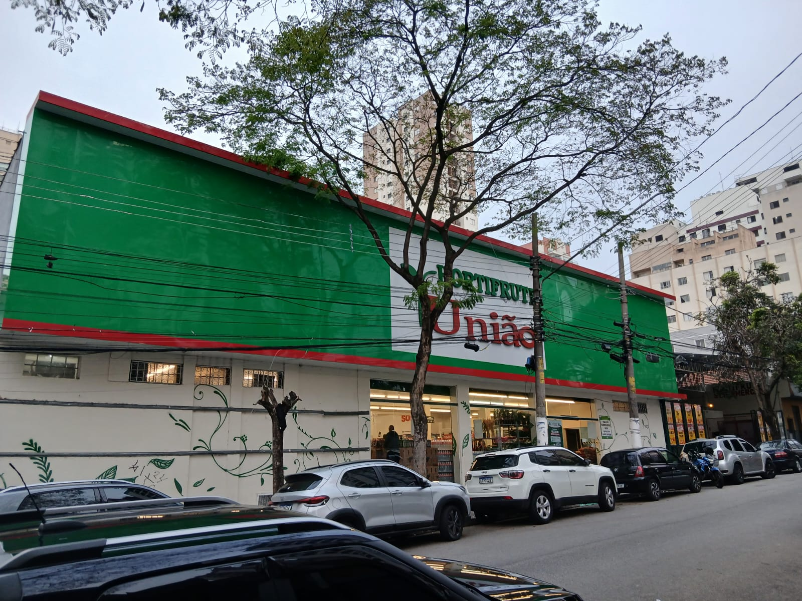
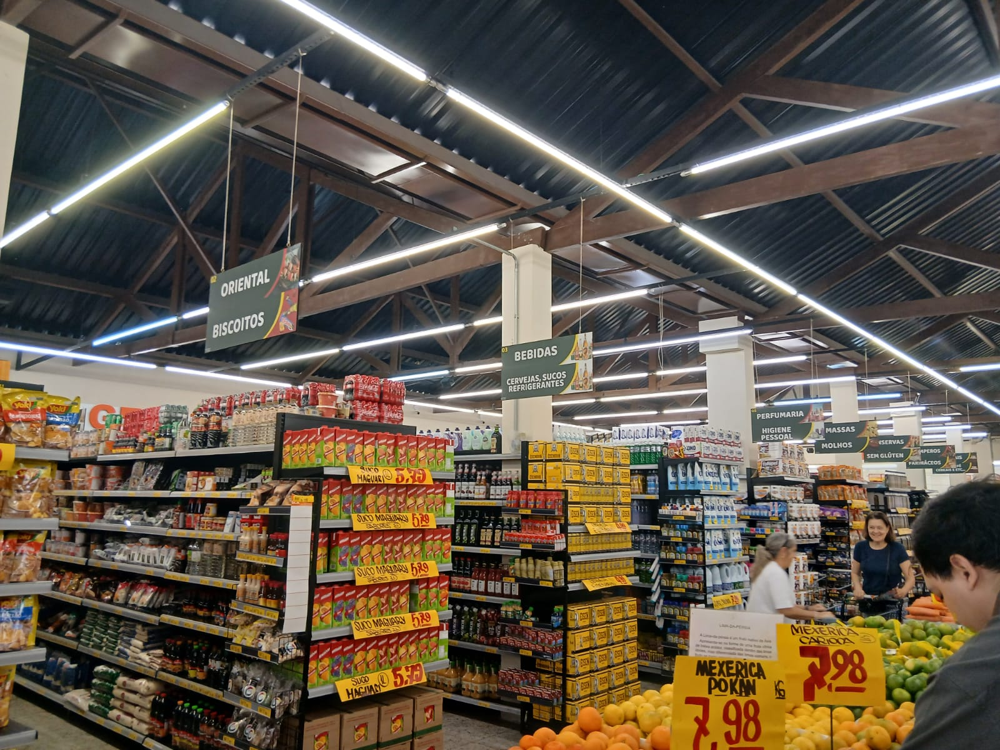
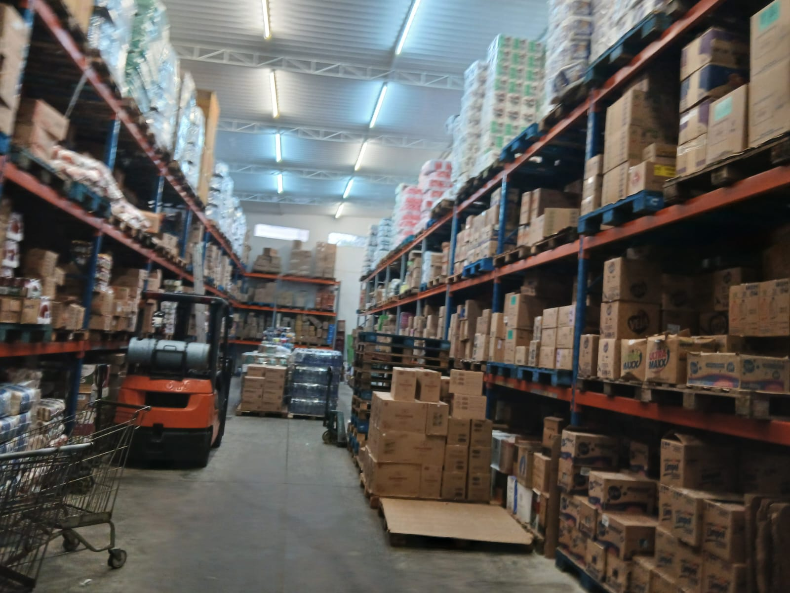
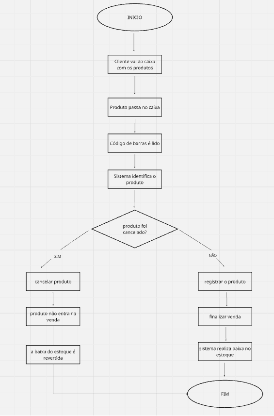
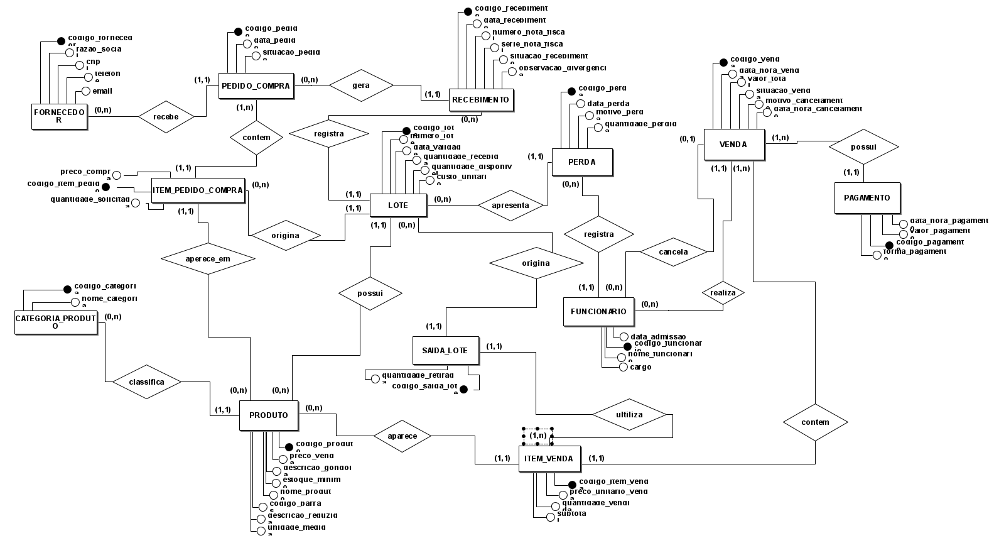

# Entrega 2 — Modelo Lógico, Implementação SQL e Apresentação Final

### Modelagem de um sistema de gestão de informações para uma organização de médio porte

---

## 1. Relatório Técnico Final

### Integrantes

| Nome completo do aluno | RGM | Usuário do GitHub |
| :---- | :---- | :---- |
| Tarcisio Santos de Oliveira | 47913061 | TarcisioT |
| Gabriela Porfírio da Silva | 48017698 | porfiriogabis |
| Henrique Moura de Oliveira | 47610972 | Bkrusher666 |
| Victor Hugo dos Santos Maciel | 48037630 | vhugosm |
| Guilherme Damasceno dos Santos | 48491683 | damascenogs |

&nbsp;

### 1.1 Revisão do Modelo Conceitual

#### Caracterização da Organização

- **Nome e natureza da organização:** Hortifruti União – Tatuapé, empresa privada com fins lucrativos, pertencente ao ramo de comércio varejista alimentício.

- **Contexto e porte:** o Hortifruti União – Tatuapé é uma empresa privada com fins lucrativos, de médio porte, que funciona todos os dias. Os números abaixo foram informados pelo responsável, Guilherme Takemoto:

  - **Pessoas:** aproximadamente 110 funcionários e 7 caixas.
  - **Vendas:** média de 2.400 transações por dia (cerca de 72.000 por mês), com ticket médio de R$ 70 e faturamento de aproximadamente R$ 5,04 milhões por mês.
  - **Produtos:** 28 mil SKUs cadastrados, entre produtos ativos e inativos.
  - **Fornecedores:** 650 cadastrados, dos quais cerca de 350 tiveram movimentação nos últimos 90 dias.
  - **Recebimento:** cerca de 1.200 lotes recebidos por semana, considerando como lote a combinação de produto, fornecedor e identificação de lote no recebimento.
  - **Perdas:** cerca de R$ 75 mil por mês, equivalentes a aproximadamente 1,5% do faturamento, incluindo vencimentos, avarias, quebras e deterioração.

- **Problemas e necessidades identificados:**

 - **P1 — Controle de validade e rastreabilidade dos lotes:** durante o levantamento realizado no Hortifruti União, foi identificado que o sistema utilizado pela empresa permite registrar datas de validade, mas essa funcionalidade não é utilizada sistematicamente. Segundo o responsável consultado, diferentes lotes de um mesmo produto utilizam o mesmo código de barras, dificultando sua identificação individual. Além disso, a organização física das mercadorias pode prejudicar a prioridade de venda dos produtos próximos do vencimento.

  - **Como o modelo resolve:** registra cada lote com identificação própria, produto, data de validade e quantidade disponível. Permite consultar os lotes próximos do vencimento e registrar perdas, apoiando decisões de reposição e redução de desperdícios. A solução complementa os procedimentos físicos de organização das mercadorias.

- **Escopo do sistema:** o projeto propõe um banco de dados relacional para organizar as informações dos principais processos do Hortifruti União, incluindo cadastro de produtos, categorias, fornecedores e funcionários; pedidos de compra e recebimento de mercadorias; controle de lotes, datas de validade, quantidades em estoque e perdas; além do registro de vendas, itens vendidos e pagamentos.

  A prioridade da solução será melhorar a rastreabilidade dos lotes e apoiar a identificação de produtos próximos do vencimento, conforme o problema P1 identificado no levantamento.

  Os processos de alterações de preços, cancelamentos, fechamento de caixa, produção própria e atividades administrativas serão documentados conforme o levantamento realizado. Sua implementação será delimitada na revisão dos requisitos e do modelo conceitual, evitando acrescentar estruturas sem justificativa.

  O projeto não prevê integração automática com o ERP existente, emissão fiscal oficial ou desenvolvimento de uma interface completa para os operadores.

- **Justificativa da escolha:** o Hortifruti União foi selecionado por ser uma organização real, com processos de compras, recebimento de mercadorias, armazenamento, vendas e controle de estoque. O contato do integrante Tarcisio Santos de Oliveira com Guilherme Takemoto, um dos responsáveis pelo estabelecimento, possibilitou a realização do levantamento de informações e da visita ao local. Durante a pesquisa, foi identificada uma dificuldade relacionada ao uso do controle de validade e à identificação individual dos lotes, tornando esse processo o foco principal da proposta de modelagem do banco de dados.

- **Evidências da organização:**

   - [Localização no Google Maps](https://www.google.com/maps/search/?api=1&query=Rua+Filipe+Camar%C3%A3o%2C+67%2C+Tatuap%C3%A9%2C+S%C3%A3o+Paulo)
  - **Perfil comercial no Google:** o vínculo com um perfil específico no Google Business Profile ainda deverá ser confirmado pelo grupo.
  - **Endereço:** Rua Filipe Camarão, nº 67, Tatuapé, São Paulo, CEP 03065-000.
  - **Número de contato:** (11) 99317-0906.
  - **Responsável entrevistado:** Guilherme Takemoto, um dos proprietários.

#### Relato da entrevista

- **Quem:** Guilherme Takemoto, um dos proprietários do Hortifruti União – Tatuapé, foi entrevistado por Tarcisio Santos de Oliveira. Tarcisio também foi responsável pela observação presencial do estabelecimento e pelo registro das evidências.

- **Quando e onde:** a entrevista foi realizada por videochamada pelo WhatsApp em 22/09/2026, com duração aproximada de uma hora. Posteriormente, Tarcisio realizou uma visita presencial ao estabelecimento em 30/09/2026, na Rua Filipe Camarão, nº 67, Tatuapé, São Paulo, para observar o local e sua rotina.

- **Limitação do levantamento:** não foi possível realizar uma nova entrevista presencial com o responsável. Por esse motivo, o grupo separou as informações fornecidas durante a videochamada dos achados obtidos durante a observação presencial. Pontos complementares (pedidos por e-mail, nota fiscal nas entradas, pagamento dividido e fechamento de caixa) foram confirmados com o responsável em contato posterior.

- **Comprovação da entrevista:** a entrevista por videochamada foi registrada por meio de uma captura de tela com o entrevistado.

- **Comprovação da visita:** a visita presencial foi documentada por meio das fotografias da fachada, do interior e do estoque apresentadas na seção de evidências da organização.

**O que foi levantado:** [Levantamento completo](levantamento/levantamento.md)

---

#### Processos de Negócio

Os processos apresentados a seguir foram identificados com base na entrevista com o responsável pelo Hortifruti União, na observação presencial e nas melhorias propostas pelo grupo. Para diferenciar o funcionamento atual da solução que estamos desenvolvendo, as funcionalidades propostas são indicadas ao longo das descrições.

##### 1. Processo de venda no caixa

O processo de venda começa quando o cliente apresenta os produtos no caixa. O funcionário identifica cada produto por meio da leitura do código de barras, permitindo a consulta de suas informações cadastrais, como nome e preço.

Para cada item da venda, devem ser registrados o produto, a quantidade e o preço unitário praticado. Após a inclusão dos itens, é calculado o valor total da compra e registrada a forma de pagamento utilizada pelo cliente.

Na implementação acadêmica, o banco armazena os dados da venda, seus itens, valores e funcionário responsável. A tabela SAIDA_LOTE permite registrar as quantidades retiradas dos lotes utilizados. A baixa correspondente no estoque foi demonstrada em operações SQL com dados fictícios; a automatização integral dessas operações e a integração com o sistema fiscal do estabelecimento não fazem parte do escopo prático.

A emissão e o registro oficial dos documentos fiscais são realizados pelo sistema utilizado pelo estabelecimento e não foram implementados neste banco acadêmico.

**Dados envolvidos:** identificação da venda, caixa, data e horário, funcionário responsável, produtos vendidos, quantidades, preços unitários, valor total, formas de pagamento e situação da venda.

##### 2. Processo de pedido e recebimento de mercadorias

Atualmente, os pedidos aos fornecedores são realizados por e-mail, conforme informado no levantamento. Na solução proposta, cada pedido de compra deverá ser registrado no sistema e vinculado a um fornecedor previamente cadastrado.

O pedido deverá conter sua identificação, data, fornecedor e os itens solicitados. Para cada item, serão registrados o produto, a quantidade solicitada e o valor unitário previsto.

No recebimento, as mercadorias são acompanhadas de nota fiscal e devem ser conferidas em relação ao pedido e ao documento fiscal. A conferência deverá considerar os produtos recebidos, as quantidades, as condições das mercadorias, os lotes e as respectivas datas de validade.

Caso sejam identificadas divergências, como quantidades diferentes das solicitadas ou produtos em condições inadequadas, a ocorrência deverá ser registrada. Após a conferência e a validação das informações, os produtos aceitos poderão ser liberados para entrada no estoque.

O tratamento de recebimentos parciais e de mercadorias recusadas deverá seguir as regras confirmadas com a organização.

**Dados envolvidos:** pedido de compra, fornecedor, razão social, CNPJ, e-mail, data e horário do pedido, produtos, quantidades solicitadas e recebidas, valores unitários, nota fiscal do fornecedor, lote, data de validade, divergências identificadas e situação do recebimento.

##### 3. Processo de controle de estoque, lotes e validade

O controle de estoque deverá manter as quantidades disponíveis de cada produto atualizadas conforme as entradas, vendas, perdas e demais movimentações registradas.

Na solução proposta, um mesmo produto poderá estar associado a diferentes lotes, cada um com identificação própria, data de entrada, data de validade e quantidade disponível. O sistema deverá permitir a consulta do estoque pelo código de barras ou pelo nome do produto, além de identificar produtos abaixo da quantidade mínima definida e lotes próximos do vencimento.

Para reduzir perdas, propõe-se a utilização da estratégia FEFO (*First Expire, First Out*), priorizando a saída dos lotes válidos cuja data de vencimento esteja mais próxima. Produtos pertencentes a lotes vencidos não poderão ser disponibilizados para venda.

Quando ocorrer uma perda, o sistema deverá registrar o produto, o lote afetado, a quantidade, a data, o motivo e o funcionário responsável. A quantidade perdida deverá ser descontada do estoque disponível, mantendo o histórico da movimentação.

**Dados envolvidos:** produto, código de barras, lote, número do lote, data de entrada, data de validade, quantidade recebida, quantidade disponível, estoque mínimo, movimentações de entrada e saída, quantidade perdida, motivo da perda e funcionário responsável.

##### 4. Processo de pagamento

Após o registro dos produtos, o cliente realiza o pagamento da compra. Conforme informado no levantamento, o Hortifruti União aceita dinheiro, cartão de débito e cartão de crédito, mas não aceita Pix. Uma mesma venda pode ser paga utilizando mais de uma dessas formas de pagamento.

Na solução proposta, cada pagamento será registrado com a respectiva forma e o valor pago. Quando uma venda utilizar mais de um meio de pagamento, a soma dos valores registrados deverá corresponder ao valor total da venda para que o pagamento seja considerado completo.

O registro deverá permitir a consulta dos valores recebidos por forma de pagamento e apoiar a conferência do caixa.

**Dados envolvidos:** venda, forma de pagamento, valor pago, data e horário, situação do pagamento e identificação do registro de pagamento.

##### 5. Processo de cancelamento

Quando o cliente desistir de um produto antes da conclusão da venda, o item deverá ser retirado da operação. Como a venda ainda não foi concluída, essa ação não deverá provocar uma baixa definitiva no estoque.

O cancelamento de uma venda já concluída deverá ser realizado somente por usuários autorizados, conforme informado: gerente ou fiscal de caixa. O sistema proposto deverá preservar o histórico da venda e registrar o motivo do cancelamento, a data, o horário e o funcionário responsável.

Quando os produtos cancelados forem devolvidos e estiverem em condições de comercialização, as respectivas quantidades deverão retornar ao estoque, preferencialmente aos lotes de origem, mantendo a rastreabilidade. Produtos danificados ou impróprios para venda deverão receber o tratamento correspondente, sem retorno automático ao estoque disponível.

**Dados envolvidos:** venda, itens cancelados, produtos, lotes de origem, quantidades, motivo do cancelamento, data e horário, funcionário responsável e situação da venda.

##### 6. Processo de alteração de preços e emissão de etiquetas

Conforme informado pelo entrevistado, a alteração do preço de um produto é permitida somente aos líderes de setor, ao gerente e aos proprietários.

Conforme o levantamento, o sistema atualmente utilizado pelo Hortifruti União já mantém o histórico de alterações de preços, com identificação de horário e usuário responsável. No banco acadêmico será mantido apenas o preço de venda atual do produto, sem tabela própria de histórico de alterações, emissão de etiquetas ou validação automática de permissões. Esses procedimentos são documentados como processos reais do estabelecimento, mas não compõem a implementação prática.

A consulta dos códigos dos produtos e a emissão de novas etiquetas poderão ser disponibilizadas aos funcionários autorizados a utilizar os computadores destinados a essa atividade, respeitando as permissões definidas pela organização.

**Dados envolvidos:** produto, código de barras, preço anterior, novo preço, data e horário da alteração, funcionário responsável e informações utilizadas na emissão da etiqueta.

##### 7. Processo de controle de acesso

O sistema atual do estabelecimento aplica permissões conforme a função do funcionário. No projeto acadêmico, a tabela FUNCIONARIO identifica os responsáveis por operações modeladas, como vendas e perdas. O banco não implementa credenciais de login, armazenamento de senhas, perfis de acesso nem autenticação. A relação de um funcionário com uma operação não comprova, por si só, que ele tinha permissão para realizá-la.

As alterações de preços serão permitidas aos líderes de setor, ao gerente e aos proprietários. As informações financeiras ficarão disponíveis somente ao setor administrativo, ao gerente e aos proprietários. O cancelamento de vendas e a validação do fechamento de caixa serão permitidos ao gerente e ao fiscal de caixa, conforme as permissões informadas no levantamento.

As operações relevantes deverão manter registros de auditoria contendo o usuário responsável, a data, o horário e a operação realizada. As senhas deverão ser armazenadas de forma segura, sem exposição em texto puro.

**Dados envolvidos:** funcionário, cargo, usuário, senha protegida, perfil de acesso, permissões por funcionalidade, data e horário da operação e registro de auditoria.

##### 8. Processo de fechamento de caixa

Ao final do dia, é realizado o fechamento do caixa. O operador faz a conferência inicial, contando o dinheiro físico e comparando o valor encontrado com o saldo esperado em dinheiro calculado pelo sistema. O fiscal de caixa ou o gerente valida o fechamento.

A conferência deverá considerar somente as movimentações em dinheiro, e não o total geral das vendas, pois parte dos pagamentos é realizada com cartão de débito ou crédito.

O fechamento de caixa foi documentado como processo existente no Hortifruti União, porém não foi implementado um módulo próprio de abertura, fundo de caixa, contagem, diferença e validação. O banco acadêmico contém informações de vendas e pagamentos para consultas gerenciais, sem substituir o controle de caixa do sistema já utilizado pela organização.

O saldo esperado em dinheiro será calculado a partir do fundo inicial e das entradas e saídas em dinheiro registradas durante o período. A diferença de caixa será calculada pela subtração do saldo esperado do valor efetivamente contado. O fechamento deverá registrar o resultado da conferência e a validação realizada pelo responsável autorizado.

**Dados envolvidos:** caixa, data, operador responsável, validador, fundo de caixa, entradas e saídas em dinheiro, saldo esperado, valor contado, diferença e situação do fechamento.

##### Processos não incluídos no escopo atual

Durante o levantamento, alguns processos comuns em estabelecimentos varejistas não foram detalhados suficientemente para serem modelados com segurança. Por esse motivo, não serão tratados como procedimentos confirmados nem implementados no escopo atual sem validação adicional com a organização.

- **Contas a pagar aos fornecedores:** não foram obtidas informações suficientes sobre o controle de vencimentos, parcelas, pagamentos e situação financeira das obrigações.
- **Elaboração da escala de funcionários:** não foram detalhados os procedimentos de definição, alteração e consulta das escalas de trabalho.
- **Controle de jornada e ponto:** não foram levantadas informações suficientes sobre os registros de entrada, saída, intervalos e apuração da jornada.

Esses processos poderão ser incorporados em uma etapa futura, caso sua existência, suas regras e os dados necessários sejam confirmados com o responsável pela organização. A ausência desses processos no escopo atual decorre da insuficiência de informações levantadas, e não de uma afirmação de que eles não existem.

##### Fluxogramas

**Fluxograma do processo de venda:**

**Fluxograma do processo de estoque:**

---

#### Requisitos do Sistema

##### Requisitos Funcionais

- **RF01 — Cadastro de produtos:** o sistema deve permitir cadastrar produtos com código único, nome, código de barras, descrição de gôndola, descrição reduzida (nota fiscal), categoria, unidade de medida (unidade ou quilo), preço de venda e estoque mínimo. Deve impedir código duplicado e produto sem categoria, e permitir edição e inativação.

- **RF02 — Cadastro de categorias:** o sistema deve permitir cadastrar categorias de produto com nome (por exemplo, fruta, verdura, laticínios). A categoria deve ser cadastrada antes dos produtos que a utilizam (RN16).

- **RF03 — Cadastro de fornecedores:** o sistema deve permitir cadastrar fornecedores com razão social, CNPJ, telefone e e-mail (obrigatório). O CNPJ deve ser único e ter os dígitos validados (RN04).

- **RF04 — Consulta de produtos por fornecedor (implementação simplificada):** o banco de dados deverá permitir identificar os produtos associados ao histórico de pedidos de cada fornecedor, utilizando as tabelas FORNECEDOR, PEDIDO_COMPRA e ITEM_PEDIDO_COMPRA. Dessa forma, será possível consultar quais produtos foram solicitados a cada fornecedor cadastrado. Nesta implementação acadêmica, não haverá um cadastro independente de produtos fornecidos por cada fornecedor, nem uma tabela associativa FORNECEDOR_PRODUTO. Portanto, fornecedores sem pedidos registrados não terão uma lista de produtos vinculados no banco.

- **RF05 — Pedido de compra:** o sistema deve permitir registrar pedidos a um fornecedor cadastrado (RN03), com um ou mais itens (produto, quantidade e preço de compra), data e situação do pedido (RN13). O pedido é enviado ao fornecedor por e-mail, por isso o e-mail é obrigatório no cadastro do fornecedor (RF03).

- **RF06 — Recebimento de mercadorias:** o sistema deve permitir registrar a entrada de mercadorias com número da nota fiscal, produto, lote, quantidade recebida e data de validade, vinculando o recebimento ao pedido de compra e registrando divergências encontradas na conferência (RN02).

- **RF07 — Consulta de estoque:** o sistema deve permitir consultar a quantidade disponível por produto e por lote, a partir do código, do nome ou do código de barras, e indicar quando o estoque estiver abaixo do mínimo (RN06).

- **RF08 — Registro de venda:** o sistema deve permitir registrar uma venda com um ou mais produtos, identificados por leitura de código de barras, com quantidade (em quilos para produtos a granel, RN11), caixa utilizado, funcionário responsável, data e hora. A venda não exige cadastro de cliente.

- **RF09 — Valor da venda:** o sistema deve calcular automaticamente o subtotal de cada item (quantidade × preço praticado) e o valor total da venda, recalculando a cada alteração dos itens.

- **RF10 — Retirada de item antes da conclusão da venda:** o sistema proposto deverá permitir retirar um produto da operação enquanto a venda ainda estiver em andamento. O item removido não deverá compor o valor total da venda nem provocar baixa definitiva no estoque. Na implementação SQL desta entrega, serão demonstrados o registro dos itens efetivamente confirmados e o cálculo do valor total da venda, sem desenvolvimento de uma interface de caixa.

- **RF11 — Cancelamento de venda (implementação simplificada):** o banco de dados deverá permitir registrar o cancelamento de uma venda concluída, preservando seu histórico. A tabela VENDA deverá armazenar a situação da venda, o motivo do cancelamento, a data e o horário e a identificação do funcionário responsável. A autorização deverá respeitar a regra RN10, sendo permitida ao gerente ou fiscal de caixa. Na implementação SQL, serão demonstradas a atualização da situação da venda e consultas ao histórico de cancelamentos. A devolução de produtos ao estoque deverá considerar os lotes originalmente utilizados e suas condições de validade e comercialização, conforme a RN05, sem permitir devolução duplicada.
  
- **RF12 — Pagamento:** o sistema deve permitir registrar o pagamento da venda em uma ou mais formas (dinheiro, débito ou crédito), com valor, data e hora de cada pagamento, e soma igual ao total da venda (RN15).
  
- **RF13 — Informações fiscais das vendas (fora da implementação prática):** o Hortifruti União deve registrar e emitir os documentos fiscais exigidos para suas operações de venda, conforme a legislação aplicável. Essa necessidade foi identificada no levantamento, mas o banco de dados acadêmico desenvolvido nesta entrega não contempla campos específicos para número de nota fiscal, data de emissão ou autorização fiscal na tabela VENDA. O registro e a emissão desses documentos permanecem sob responsabilidade do sistema fiscal utilizado pelo estabelecimento. A integração dessas informações ao banco proposto poderá ser considerada em uma evolução futura.
  
- **RF14 — Registro de saída por lote (implementação simplificada):** o banco de dados deverá permitir registrar, por meio da tabela SAIDA_LOTE, quais lotes foram utilizados para atender os itens de uma venda e as quantidades retiradas. A massa de dados demonstrou a associação entre venda, produto e lote, além da atualização do saldo disponível. A seleção automática dos lotes conforme o método FEFO não foi implementada integralmente e permanece como melhoria futura.
    
- **RF15 — Controle de lotes vencidos e quantidade disponível (implementação simplificada):** o banco permitirá consultar a validade e a quantidade disponível dos lotes para identificar mercadorias vencidas e situações de estoque insuficiente. As consultas SQL demonstradas apoiam essa verificação, mas não implementam um bloqueio automático e universal de vendas com lotes vencidos ou saldo insuficiente. Essas validações deverão ser incorporadas à lógica transacional de uma aplicação ou a procedimentos específicos do banco.
  
- **RF16 — Consulta de validade:** o sistema deve permitir consultar lotes vencidos e próximos do vencimento, com produto, lote, quantidade disponível e data de validade.

- **RF17 — Identificação de lotes próximos do vencimento (implementação simplificada):** o banco permitirá identificar, por consulta SQL, os lotes que possuem saldo positivo e estão próximos da data de validade. A consulta gerencial G01 foi testada utilizando um intervalo de sete dias como parâmetro acadêmico. Não foram implementadas notificações automáticas nem a configuração individual de prazos de alerta por produto ou categoria.
  
- **RF18 — Registro de perdas:** o sistema deve permitir registrar perdas (vencimento, dano ou estrago) com lote, quantidade, data, motivo e funcionário, descontando a quantidade do lote (RN07, RN17).

- **RF19 — Alteração de preços (implementação simplificada):** conforme informado pelo responsável pelo Hortifruti União, o sistema atualmente utilizado já permite registrar alterações de preços, identificando o horário e o login do funcionário responsável. No banco de dados proposto, será mantido o preço de venda atualizado de cada produto. O processo de alteração de preços será documentado no levantamento, mas a implementação de um módulo próprio de histórico de alterações e controle de permissões ficará fora do escopo prático desta entrega.
    
- **RF20 — Consulta de produtos e informações para etiquetas (implementação limitada):** o banco de dados deverá permitir consultar o código do produto, código de barras, nome utilizado na gôndola e preço de venda atualizado. Essas informações poderão ser utilizadas futuramente para gerar etiquetas. A criação de interfaces de impressão e a comunicação com impressoras não fazem parte da implementação prática desta entrega.
  
- **RF21 — Cadastro de funcionários (implementação simplificada):** o banco de dados deverá permitir cadastrar funcionários com código identificador, nome, cargo e data de admissão, possibilitando associá-los às operações registradas, como vendas e perdas de mercadorias. O controle de login, senhas, perfis de acesso e autenticação continuará sendo uma responsabilidade do sistema utilizado atualmente pela empresa e não será implementado no banco de dados acadêmico desta entrega. O projeto manterá a identificação do funcionário responsável pelas operações que forem efetivamente modeladas.
  
- **RF22 — Fechamento de caixa (fora da implementação prática):** conforme informado pelo responsável pelo Hortifruti União, o fechamento de caixa é realizado ao final do período, com conferência inicial do operador e validação pelo fiscal de caixa ou gerente. O processo envolve a verificação dos valores recebidos em dinheiro, considerando o fundo inicial e as movimentações do período. Nesta entrega, o fechamento de caixa será documentado como um processo existente na organização, mas não será desenvolvido um módulo próprio de abertura, conferência e validação de caixa. O banco de dados proposto manterá os registros de vendas e pagamentos necessários para consultas gerenciais, sem substituir o controle de caixa realizado pelo sistema atual.

##### Requisitos Não Funcionais

- **RNF01 — Desempenho (implementação limitada):** considerando que o Hortifruti União possui 7 caixas e realiza aproximadamente 2.400 transações por dia, o banco de dados deverá ser estruturado para permitir consultas eficientes de produtos, vendas, lotes e estoque. Nesta entrega, serão considerados tipos de dados adequados, chaves primárias, chaves estrangeiras e índices para apoiar o desempenho das consultas SQL. A meta de resposta inferior a 3 segundos e o funcionamento simultâneo dos 7 caixas não serão validados nesta etapa, pois dependem de testes de carga e de uma aplicação integrada.
  
- **RNF02 — Disponibilidade (implementação limitada):** o sistema proposto deverá buscar disponibilidade durante o horário de funcionamento do Hortifruti União. Nesta entrega, o grupo desenvolverá e testará a estrutura do banco de dados em MySQL, sem implementar mecanismos de alta disponibilidade, funcionamento dos caixas sem internet ou sincronização automática após quedas de conexão. Essas funcionalidades ficam previstas como melhorias futuras.
  
- **RNF03 — Segurança e proteção dos dados (implementação limitada):** o banco de dados deverá preservar a integridade e a proteção das informações registradas, utilizando chaves primárias, chaves estrangeiras e restrições adequadas para evitar registros inconsistentes. O acesso ao banco deverá ser limitado a usuários autorizados no ambiente MySQL. A implementação de telas de login, armazenamento de senhas de funcionários e gerenciamento de perfis e permissões não faz parte do escopo prático desta entrega. As regras de acesso utilizadas pelo sistema atual do Hortifruti União permanecerão documentadas no levantamento.
    
- **RNF04 — Usabilidade e organização dos dados (implementação limitada):** o banco de dados deverá utilizar nomes claros e padronizados para tabelas e colunas, facilitando a compreensão, a manutenção e a elaboração de consultas SQL. O projeto também deverá apresentar um dicionário de dados com a descrição das estruturas implementadas. A criação e a avaliação de uma interface gráfica para operadores de caixa não fazem parte do escopo prático desta entrega, podendo ser realizadas em uma evolução futura do sistema.
  
- **RNF05 — Recuperação de dados (implementação limitada):** o projeto deverá considerar a importância de realizar cópias de segurança para evitar a perda de informações sobre produtos, vendas, lotes, estoque e operações registradas. Nesta entrega, o grupo poderá demonstrar o procedimento de exportação e restauração do banco de dados MySQL como medida básica de recuperação. A configuração de backups automáticos diários, armazenamento externo e planos de recuperação em ambiente de produção ficará como evolução futura do sistema.
  
- **RNF06 — Integridade das movimentações (implementação simplificada):** o banco de dados deverá preservar a consistência dos registros de venda, das saídas de lote e das atualizações de estoque. Foram realizados testes de operações SQL e consultas de auditoria com dados fictícios. Entretanto, a implementação atual não garante automaticamente, em todas as situações, que o registro da venda e a baixa do estoque ocorram em uma única transação nem que todos os saldos negativos sejam bloqueados. Essas garantias dependerão de validações transacionais adicionais.
  
- **RNF07 — Rastreabilidade e verificação da integridade dos dados (implementação simplificada):** o banco de dados deverá permitir rastrear os produtos desde o recebimento até as movimentações de estoque, vendas e perdas, identificando os lotes envolvidos, suas quantidades e datas de validade. Também deverão ser elaboradas consultas SQL de auditoria para verificar a consistência dos registros, como quantidades negativas, lotes vencidos com estoque disponível e movimentações incompatíveis com as regras de negócio.

  O histórico de alterações de preços e o controle de permissões de usuários, já existentes no sistema utilizado pela organização, serão documentados no levantamento, mas não terão um módulo próprio de auditoria implementado neste projeto acadêmico.
  
- **RNF08 — Conformidade legal (implementação limitada):** o projeto reconhece a necessidade de proteção dos dados pessoais de funcionários e contatos de fornecedores, conforme os princípios aplicáveis da Lei Geral de Proteção de Dados (LGPD). O grupo deverá utilizar dados fictícios para os testes e limitar o acesso ao ambiente de banco de dados. O cumprimento das obrigações fiscais continua sendo responsabilidade da organização e de seu sistema fiscal. O banco acadêmico não implementa emissão, autorização, transmissão ou armazenamento específico de notas fiscais de saída na tabela VENDA.
  
- **RNF09 — Integração e centralização dos dados (implementação limitada):** o banco de dados proposto deverá organizar de forma centralizada as informações de produtos, fornecedores, compras, lotes, estoque, vendas e pagamentos, mantendo os relacionamentos necessários para garantir a integridade dos registros. Embora o Hortifruti União utilize atualmente o ERP VR Software, a integração automática com esse sistema não será desenvolvida nesta entrega. A possibilidade de comunicação entre os sistemas ficará prevista como evolução futura, dependendo de análise técnica e disponibilidade de mecanismos de integração.

**Requisitos típicos não incluídos:** cadastro de clientes e programa de fidelidade (não utilizados no registro das vendas conforme o levantamento), além de pagamento por Pix (não aceito pelo estabelecimento). Contas a pagar, elaboração de escalas e controle de ponto não foram detalhados suficientemente para implementação nesta entrega e não integram o problema principal P1. Permanecem como possibilidades de evolução futura, conforme novo levantamento.

---

#### Regras de Negócio

**Origem das regras:** as marcadas com **[Entrevista]** foram informadas pelo responsável, Guilherme Takemoto. As marcadas com **[Proposta]** foram elaboradas pelo grupo a partir dos processos mapeados e de regras típicas de supermercados e hortifrutis, levantadas com apoio de IA (ver a seção 6, Uso de Inteligência Artificial), e ainda não foram validadas individualmente com o responsável.

**Regras operacionais**

- **RN01 — Bloqueio de venda de produtos vencidos [Entrevista]:** o sistema não deve permitir a venda de produto cujo lote tenha data de validade anterior à data da venda. Segundo o responsável, vender produto vencido é crime.

- **RN02 — Entrada de estoque com nota fiscal [Entrevista]:** toda entrada de mercadoria deve ser registrada com a nota fiscal do fornecedor, informando também lote, quantidade recebida e data de validade. Sem a nota fiscal, o sistema não permite registrar a entrada.

- **RN03 — Pedido só a fornecedor cadastrado [Proposta]:** um pedido de compra só pode ser feito a um fornecedor previamente cadastrado.

- **RN04 — Fornecedor com CNPJ válido [Proposta]:** o fornecedor só pode ser cadastrado com CNPJ válido e único, razão social, telefone e e-mail preenchidos.

- **RN05 — Cancelamento de venda [Proposta / Implementação simplificada]:** uma venda concluída poderá ser cancelada mediante autorização operacional do gerente ou fiscal de caixa, conforme a RN10. O banco de dados deverá preservar o registro original da venda e armazenar sua situação, o motivo do cancelamento, a data, o horário e a identificação do funcionário responsável.

  Na implementação SQL, será demonstrada a atualização da situação da venda e a consulta ao histórico de cancelamentos. A eventual devolução de produtos ao estoque deverá considerar os lotes originalmente utilizados, suas datas de validade e as condições de comercialização, impedindo a devolução duplicada de quantidades.

  A verificação automática das permissões dos funcionários e a execução completa da reposição de estoque em cancelamentos não fazem parte da implementação prática desta entrega. Essas limitações serão identificadas na documentação, sem apresentar tais controles como funcionalidades implementadas.
  
- **RN06 — Estoque mínimo [Entrevista]:** cada produto tem uma quantidade mínima de estoque. Quando a quantidade disponível fica abaixo dela, o sistema alerta para avaliar a reposição. O comprador é o principal responsável por definir (parametrizar) o estoque mínimo, com apoio do ERP e supervisão do gerente de compras.

- **RN07 — Perdas por vencimento [Proposta]:** quando um lote vence, ele não pode mais ser vendido. A perda é registrada com lote, quantidade, data, motivo "vencimento" e funcionário responsável, e descontada do estoque do lote.

- **RN09 — Alerta de vencimento [Proposta]:** o sistema avisa quando um lote está próximo do vencimento. O prazo de antecedência é um parâmetro configurável por produto ou categoria; o valor ainda não foi informado pelo responsável e deve ser confirmado.

- **RN13 — Pedido de compra com itens [Proposta]:** todo pedido de compra contém ao menos um item. Cada item representa um produto e pertence a um único pedido.

- **RN22 — Consistência entre pedido, recebimento e lote [Proposta]:** cada lote recebido deverá estar associado a um recebimento e a um item de pedido de compra. O recebimento e o item comprado deverão pertencer ao mesmo pedido, e o produto associado ao lote deverá ser o mesmo produto registrado no item de compra. Essa consistência será verificada na implementação do modelo lógico e por meio de restrições ou consultas SQL de validação.

- **RN14 — Saída por lote e estratégia FEFO [Proposta / Implementação simplificada]:** cada item vendido poderá ser associado a um ou mais lotes por meio da tabela SAIDA_LOTE, registrando a quantidade retirada de cada lote. A estratégia FEFO (*First Expire, First Out*) estabelece a prioridade de utilização dos lotes válidos com vencimento mais próximo. Nesta implementação acadêmica, a rastreabilidade das saídas foi demonstrada por meio de registros e consultas SQL, mas a seleção automática dos lotes conforme o FEFO não foi implementada integralmente.
  
- **RN15 — Formas de pagamento [Entrevista]:** o mercado aceita dinheiro, cartão de débito e cartão de crédito, mas não aceita Pix. O pagamento de uma venda pode ser dividido entre essas formas, desde que a soma seja igual ao total da venda.

- **RN16 — Categoria do produto [Proposta]:** todo produto pertence a uma única categoria, que deve estar cadastrada antes do produto. Uma categoria pode ter vários produtos (por exemplo, a categoria fruta com banana e pera).

- **RN17 — Perdas por outros motivos [Proposta]:** perdas por dano, estrago ou outros motivos também são registradas com lote, quantidade, data, motivo e funcionário responsável, e descontadas do estoque do lote. A proposta é registrar todas as perdas digitalmente.

- **RN18 — Controle de quantidade vendida [Proposta]:** no banco de dados acadêmico proposto, a quantidade retirada dos lotes não deverá ultrapassar o estoque disponível, e lotes vencidos não deverão ser utilizados para atender vendas. Essa é uma melhoria em relação à situação relatada na entrevista, pois o sistema atualmente utilizado pelo Hortifruti União pode apresentar estoque negativo. A aplicação dessa regra dependerá de validações e operações de atualização consistentes na implementação SQL.
  
- **RN19 — Baixa de estoque e rastreabilidade por lote [Entrevista / Proposta]:** conforme relatado na entrevista, o sistema atual do Hortifruti União realiza a baixa automática do estoque quando uma venda é concluída. Como melhoria proposta neste projeto acadêmico, cada quantidade vendida deverá ser associada ao lote de origem por meio da entidade SAIDA_LOTE, permitindo rastrear a validade e a quantidade retirada. A atualização da quantidade disponível de cada lote deverá ocorrer de forma consistente, sem permitir saldo negativo. A seleção do lote e a aplicação dessa regra dependerão das operações implementadas no SQL.
  
- **RN20 — Preservação dos registros [Proposta / Implementação simplificada]:** as vendas canceladas deverão permanecer registradas no banco de dados, com sua situação atualizada, motivo, data e horário do cancelamento e identificação do funcionário responsável. Os registros de pagamentos e perdas também deverão ser preservados para permitir consultas e verificações posteriores. Nesta entrega, não será implementado um histórico completo de todas as alterações realizadas nos dados, nem um módulo específico de auditoria de usuários.
  
- **RN21 — Fechamento de caixa [Entrevista / Fora da implementação prática]:** conforme informado pelo responsável pelo Hortifruti União, o fechamento do caixa é realizado ao final do período de operação. O operador confere inicialmente o dinheiro físico, e o fiscal de caixa ou gerente realiza a validação. A conferência considera o fundo inicial, os recebimentos em dinheiro e as demais movimentações em espécie, sem incluir os pagamentos realizados por cartão no saldo físico.

Neste projeto acadêmico, o fechamento de caixa será documentado como um processo existente na organização, mas não será implementado um módulo próprio para abertura, fechamento, conferência e validação. O banco de dados proposto armazenará os registros de vendas e pagamentos, permitindo consultas aos valores recebidos por forma de pagamento, sem substituir o sistema de controle de caixa utilizado pelo estabelecimento.

**Restrições organizacionais e legais**

- **RN08 — Obrigatoriedade fiscal [Entrevista / Fora da implementação prática]:** conforme informado pelo responsável pelo Hortifruti União, o estabelecimento deve cumprir as obrigações fiscais aplicáveis às suas operações de venda. A emissão, a autorização e o registro oficial dos documentos fiscais continuam sendo realizados pelo sistema utilizado pela organização. Nesta entrega acadêmica, o banco de dados proposto não implementa emissão fiscal, integração com serviços fiscais externos nem armazenamento de dados específicos de notas fiscais de saída na tabela VENDA. Essa limitação não elimina a obrigação fiscal do estabelecimento; apenas delimita o escopo do banco desenvolvido pelo grupo. A integração fiscal poderá ser considerada em uma evolução futura do projeto.
  
- **RN10 — Permissões por função [Entrevista / Implementação limitada]:** conforme informado pelo responsável pelo Hortifruti União, determinadas operações do sistema atual possuem restrições de acesso de acordo com a função exercida pelo funcionário. Alterações de preços são realizadas por líderes de setor, gerente e proprietários; cancelamentos de vendas e validações de fechamento de caixa são autorizados ao gerente ou fiscal de caixa; e informações financeiras são acessadas por funcionários autorizados da administração e gestão.

  No projeto acadêmico, essas restrições serão documentadas como regras existentes na organização. A implementação de login, autenticação e gerenciamento de perfis e permissões ficará fora do escopo prático. O banco de dados proposto registrará a identificação dos funcionários responsáveis pelas operações efetivamente modeladas, sem afirmar que essa identificação, isoladamente, garante a autorização de acesso.
    
- **RN11 — Produtos a granel [Proposta]:** produtos vendidos por peso têm a quantidade registrada em quilos e o valor calculado pelo preço por quilo. As balanças devem atender às exigências do Inmetro.

- **RN12 — Proteção de dados pessoais, LGPD [Proposta]:** o sistema deve proteger os dados pessoais de funcionários e de contatos de fornecedores, como nome, CPF e telefone. Só funcionários autorizados podem acessá-los, e o armazenamento deve seguir a Lei Geral de Proteção de Dados.

**Regras comuns não incluídas**

- Cadastro de clientes e programa de fidelidade: o mercado não cadastra clientes.
- Pagamento por Pix: o mercado não o aceita.
- Normas sanitárias, contas a pagar e escala de funcionários: não foram levantadas na entrevista e não estão ligadas ao problema principal (P1). Ficam como evolução futura, a confirmar com o responsável.

---

#### Delimitação do Escopo da Implementação

A implementação do banco de dados do Hortifruti União terá como prioridade atender ao problema principal identificado durante o levantamento:

- **P1 — Controle de validade e rastreabilidade dos lotes:** registrar os lotes de produtos, suas datas de validade, quantidades disponíveis e perdas, permitindo identificar mercadorias vencidas ou próximas do vencimento e apoiar o controle de estoque.

A solução também contemplará os dados essenciais dos processos de cadastro de produtos, fornecedores, compras, recebimentos e vendas, mantendo a coerência com as operações da organização.

#### Revisão do Modelo Conceitual e Simplificação do Escopo

Após novas informações fornecidas pelo responsável pelo Hortifruti União, o grupo decidiu concentrar a solução no problema P1 — Controle de validade e rastreabilidade dos lotes.

Foi confirmado que o sistema atualmente utilizado pela empresa já registra alterações de preços, incluindo o horário e o login do responsável. Por esse motivo, o controle de acesso e o histórico de alterações de preços deixaram de ser tratados como um segundo problema principal.

O modelo conceitual foi revisado para representar os principais processos incluídos na entrega, priorizando produtos, fornecedores, compras, recebimentos, lotes, perdas e vendas. As funcionalidades complementares foram delimitadas de acordo com os requisitos e informações levantados, evitando a criação de estruturas sem justificativa para o escopo acadêmico.

**Funcionalidades incluídas no escopo:**

- Cadastro de produtos, categorias, fornecedores e funcionários.
- Registro de pedidos de compra e seus itens.
- Registro do recebimento de mercadorias e das informações da nota fiscal de entrada.
- Controle de lotes, datas de validade, quantidades disponíveis e perdas.
- Registro de vendas, itens vendidos e pagamentos.
- Registro das saídas de produtos por lote, permitindo identificar as quantidades retiradas e seus lotes de origem. A seleção automática de lotes pelo método FEFO permanece como melhoria futura.
- Consultas SQL para identificar lotes próximos do vencimento, produtos abaixo do estoque mínimo e perdas registradas.
- Consultas gerenciais para apoiar o acompanhamento do estoque e das vendas.

**Funcionalidades fora do escopo da implementação prática:**

- Emissão e autorização fiscal de notas fiscais junto aos órgãos competentes.
- Impressão física de etiquetas de preços.
- Integração automática com o ERP VR Software utilizado pelo estabelecimento.
- Operação dos caixas sem internet e sincronização posterior.
- Desenvolvimento de interfaces completas para operadores e gestores.
- Implementação de modelos preditivos de inteligência artificial.

Essas funcionalidades poderão ser consideradas em evoluções futuras do projeto. A emissão fiscal continuará sendo reconhecida como uma necessidade operacional e legal do estabelecimento, mas sua integração técnica não será desenvolvida nesta entrega.

**Limites da implementação:** o projeto será demonstrado por meio do modelo lógico relacional, scripts SQL, dados fictícios e consultas realizadas no MySQL. As regras de autorização, a estratégia FEFO e as operações de estoque serão representadas e testadas na medida em que forem implementadas no banco de dados, sem pressupor a existência de uma aplicação completa.

A delimitação do escopo busca concentrar o desenvolvimento no problema P1 — Controle de validade e rastreabilidade dos lotes, mantendo o registro dos dados essenciais dos demais processos da organização. Dessa forma, o grupo pretende garantir a coerência entre o levantamento de requisitos, o DER conceitual, o modelo lógico e a implementação SQL, sem acrescentar funcionalidades desnecessárias.

#### DER Conceitual Revisado

**Software utilizado:** brModelo 3.2.0. O DER conceitual foi elaborado utilizando a notação de entidades, atributos, relacionamentos e cardinalidades mínimas e máximas do brModelo. As chaves estrangeiras serão representadas no modelo lógico.

**Situação do DER conceitual:** o Diagrama Entidade-Relacionamento (DER) conceitual do Hortifruti União foi elaborado no brModelo 3.2.0, considerando os processos de cadastro, compras, recebimento, controle de lotes, perdas e vendas, com prioridade para o problema P1 — Controle de validade e rastreabilidade dos lotes. O diagrama contém as entidades, os atributos, os identificadores, os relacionamentos e as cardinalidades definidos pelo grupo. Sua representação será disponibilizada na pasta `diagramas/`, no arquivo `der_conceitual.png`, após a conferência final de correspondência com o modelo lógico implementado.

**Resumo das entidades e relacionamentos do DER revisado:**

| Entidade 1 | Relacionamento | Entidade 2 | Cardinalidade |
|---|---|---|---|
| PRODUTO | POSSUI | LOTE | (0,N) / (1,1) |
| CATEGORIA_PRODUTO | CLASSIFICA | PRODUTO | (0,N) / (1,1) |
| FORNECEDOR | RECEBE | PEDIDO_COMPRA | (0,N) / (1,1) |
| PEDIDO_COMPRA | CONTÉM | ITEM_PEDIDO_COMPRA | (1,N) / (1,1) |
| PRODUTO | SOLICITADO | ITEM_PEDIDO_COMPRA | (0,N) / (1,1) |
| FUNCIONARIO | REGISTRA | VENDA | (0,N) / (1,1) |
| FUNCIONARIO | CANCELA | VENDA | (0,N) / (0,1) |
| VENDA | CONTÉM | ITEM_VENDA | (1,N) / (1,1) |
| PRODUTO | VENDIDO | ITEM_VENDA | (0,N) / (1,1) |
| VENDA | POSSUI | PAGAMENTO | (1,N) / (1,1) |
| LOTE | REGISTRA | PERDA | (0,N) / (1,1) |
| FUNCIONARIO | REGISTRA | PERDA | (0,N) / (1,1) |
| ITEM_VENDA | POSSUI | SAIDA_LOTE | (1,N) / (1,1) |
| LOTE | ORIGINA | SAIDA_LOTE | (0,N) / (1,1) |
| PEDIDO_COMPRA | GERA | RECEBIMENTO | (0,N) / (1,1) |
| RECEBIMENTO | REGISTRA | LOTE | (0,N) / (1,1) |
| ITEM_PEDIDO_COMPRA | ORIGINA | LOTE | (0,N) / (1,1) |

*As cardinalidades estão apresentadas na ordem das entidades indicadas em cada linha.*

**Apontamentos da correção da Entrega 1:**

| Apontamento da correção da E1 | O que mudou no trabalho | Por quê |
|---|---|---|
| Processos de negócio incompletos | Foram detalhados os processos de vendas, compras, recebimento, estoque, pagamentos, cancelamentos, alterações de preços, controle de acesso e fechamento de caixa. | Para apresentar melhor o funcionamento do mercado e as melhorias propostas. |
| Fluxogramas apenas como anexos do GitHub | Os fluxogramas foram organizados como arquivos do repositório. | Para permitir que o professor visualize os arquivos diretamente pelo projeto. |
| Regras de negócio incompletas | Foram acrescentadas regras sobre validade, estoque mínimo, FEFO, perdas, pagamentos, permissões, produtos a granel e LGPD. | Para deixar o modelo mais completo e coerente com os processos. |
| Inconsistência no cadastro de clientes | A entidade CLIENTE foi retirada do modelo proposto. | O mercado não realiza cadastro de clientes para registrar as vendas. |
| Cardinalidades e relacionamentos incorretos | Foram revisadas as cardinalidades e criadas entidades para representar itens de compra, itens de venda, lotes, pagamentos e perdas. | Para representar corretamente as relações entre os dados. |
| DER não disponível como arquivo do repositório | O DER foi reconstruído no brModelo e será disponibilizado como arquivo do projeto. | Para corrigir o problema de entrega apontado pelo professor. |
| Dicionário de dados incompleto | O dicionário será atualizado com base no modelo lógico revisado, incluindo chaves, tipos de dados, restrições e índices. | Para corrigir as inconsistências e completar a documentação técnica. |
| Justificativas técnicas superficiais | Serão apresentadas justificativas para as entidades, os relacionamentos, as cardinalidades e as decisões de implementação. | Para demonstrar o entendimento do grupo sobre o modelo desenvolvido. |

### 1.2 Conversão do Modelo Conceitual para o Modelo Lógico

**Entidades → Tabelas:** as entidades identificadas no DER conceitual foram convertidas em 13 tabelas no modelo lógico relacional: PRODUTO, CATEGORIA_PRODUTO, FORNECEDOR, PEDIDO_COMPRA, ITEM_PEDIDO_COMPRA, RECEBIMENTO, LOTE, FUNCIONARIO, VENDA, ITEM_VENDA, PAGAMENTO, PERDA e SAIDA_LOTE. A estrutura foi implementada e testada no MySQL 8.0, contendo 13 chaves primárias e 17 chaves estrangeiras. Cada tabela representa informações necessárias aos processos incluídos no escopo acadêmico, com prioridade para o controle de validade e a rastreabilidade dos lotes (P1).

**Atributos → Colunas:** os atributos de cada entidade foram transformados em colunas das respectivas tabelas. Por exemplo, os atributos `codigo_produto`, `nome_produto`, `preco_venda` e `unidade_medida` compõem a tabela PRODUTO. Os atributos identificadores deram origem às chaves primárias, enquanto os campos de referência às demais tabelas foram utilizados como chaves estrangeiras.

**Relacionamentos → Chaves:** Os relacionamentos entre as entidades foram analisados para definir as chaves estrangeiras. Por exemplo, cada lote pertence a um produto, por isso a tabela LOTE deve conter a chave estrangeira codigo_produto, referenciando a tabela PRODUTO.

**Cardinalidades:** nos relacionamentos 1:N, a chave estrangeira é inserida na tabela do lado N. Em relacionamentos N:N, normalmente é necessária uma tabela associativa para representar todas as combinações possíveis entre as entidades.

Na implementação acadêmica desta entrega, a relação entre fornecedores e produtos é identificada indiretamente pelas tabelas PEDIDO_COMPRA e ITEM_PEDIDO_COMPRA. Assim, é possível consultar quais produtos foram solicitados a cada fornecedor, sem criar uma tabela FORNECEDOR_PRODUTO. Essa decisão simplifica o modelo para os processos efetivamente implementados, mas não representa um cadastro independente de produtos fornecidos por cada fornecedor.

**Generalização/especialização:** Não foram utilizados relacionamentos de generalização ou especialização no modelo conceitual, pois as entidades identificadas não exigiram esse tipo de estrutura para representar o escopo definido pelo grupo.

### 1.3 Definição de Chaves Primárias e Estrangeiras

**Definição das chaves:** o modelo lógico do Hortifruti União possui 13 tabelas, com chaves primárias para identificação dos registros e 17 chaves estrangeiras para representar os relacionamentos. A estrutura foi implementada e testada no MySQL 8.0.

| Tabela | Chave primária (PK) | Chaves estrangeiras (FK) |
|---|---|---|
| FORNECEDOR | `codigo_fornecedor` | Não possui |
| CATEGORIA_PRODUTO | `codigo_categoria` | Não possui |
| FUNCIONARIO | `codigo_funcionario` | Não possui |
| PRODUTO | `codigo_produto` | `codigo_categoria` → CATEGORIA_PRODUTO |
| PEDIDO_COMPRA | `codigo_pedido` | `codigo_fornecedor` → FORNECEDOR |
| ITEM_PEDIDO_COMPRA | `codigo_item_pedido` | `codigo_pedido` → PEDIDO_COMPRA; `codigo_produto` → PRODUTO |
| RECEBIMENTO | `codigo_recebimento` | `codigo_pedido` → PEDIDO_COMPRA |
| LOTE | `codigo_lote` | `codigo_produto` → PRODUTO; `codigo_item_pedido` → ITEM_PEDIDO_COMPRA; `codigo_recebimento` → RECEBIMENTO |
| PERDA | `codigo_perda` | `codigo_lote` → LOTE; `codigo_funcionario` → FUNCIONARIO |
| VENDA | `codigo_venda` | `codigo_funcionario` → FUNCIONARIO; `codigo_funcionario_cancelamento` → FUNCIONARIO |
| ITEM_VENDA | `codigo_item_venda` | `codigo_venda` → VENDA; `codigo_produto` → PRODUTO |
| PAGAMENTO | `codigo_pagamento` | `codigo_venda` → VENDA |
| SAIDA_LOTE | `codigo_saida_lote` | `codigo_lote` → LOTE; `codigo_item_venda` → ITEM_VENDA |

**Observação:** o modelo implementado não possui uma tabela associativa direta entre FORNECEDOR e PRODUTO. A identificação dos produtos solicitados a cada fornecedor é realizada por meio das tabelas PEDIDO_COMPRA e ITEM_PEDIDO_COMPRA. Essa simplificação foi adotada para manter o foco nos processos de compra e recebimento incluídos no escopo acadêmico. A correspondência dessa decisão com o desenho final do DER conceitual ainda precisa ser conferida antes da exportação do diagrama.

### 1.4 Processo de Normalização (1FN, 2FN e 3FN)

**1FN — Primeira Forma Normal:** As tabelas foram organizadas para que cada coluna contenha um único valor, sem listas de informações ou grupos repetidos. Por exemplo, os produtos de uma venda são registrados separadamente na tabela ITEM_VENDA, e os produtos de um pedido de compra ficam na tabela ITEM_PEDIDO_COMPRA. Isso permite armazenar vários itens sem repetir as informações gerais da venda ou do pedido.

**2FN — Segunda Forma Normal:** para atender à Segunda Forma Normal, os atributos não-chave devem depender integralmente da chave primária, evitando dependências parciais. No modelo do Hortifruti União, a tabela ITEM_PEDIDO_COMPRA utiliza a chave primária `codigo_item_pedido` para identificar cada item de compra. Nela são registrados os dados específicos do item, enquanto informações do fornecedor ficam na tabela FORNECEDOR e os dados cadastrais do produto permanecem na tabela PRODUTO. Como as tabelas implementadas utilizam chaves primárias simples, não há dependências parciais de chaves primárias compostas nesse modelo.

**3FN — Terceira Forma Normal:** As tabelas foram organizadas para evitar dependências transitivas entre atributos não-chave. Por exemplo, PEDIDO_COMPRA armazena codigo_fornecedor como chave estrangeira, enquanto a razão social, o CNPJ e o telefone permanecem na tabela FORNECEDOR. Da mesma forma, PRODUTO guarda codigo_categoria, e o nome da categoria permanece em CATEGORIA_PRODUTO.

**Observação sobre a tabela LOTE:** a tabela LOTE armazena `codigo_produto` e `codigo_item_pedido` para facilitar a identificação direta do produto e a rastreabilidade até o item de compra. Entretanto, como ITEM_PEDIDO_COMPRA também identifica o produto solicitado, existe uma redundância potencial entre essas referências. A regra RN22 determina que ambas correspondam ao mesmo produto. Na implementação acadêmica, essa consistência foi verificada por consultas SQL de auditoria, mas não é garantida exclusivamente pelas chaves estrangeiras individuais. Essa decisão representa uma limitação de normalização e integridade que deverá ser considerada em uma evolução do modelo.

**Justificativa do processo:** a normalização foi utilizada para reduzir a repetição de informações, evitar inconsistências nos cadastros e facilitar a manutenção do banco de dados. A separação de entidades como PRODUTO, FORNECEDOR, PEDIDO_COMPRA, ITEM_PEDIDO_COMPRA, VENDA e ITEM_VENDA demonstra a aplicação dos princípios da 1FN, 2FN e 3FN nas partes correspondentes do modelo. Entretanto, a tabela LOTE mantém uma redundância potencial entre `codigo_produto` e `codigo_item_pedido`, conforme descrito anteriormente. Por isso, não se afirma que todas as tabelas estejam integralmente em 3FN. A consistência dessas referências foi verificada nas consultas de auditoria da implementação acadêmica.

### 1.5 Justificativas Técnicas das Decisões

**Chaves primárias:** cada uma das 13 tabelas do modelo possui uma chave primária simples, formada por um único atributo identificador. Foram utilizados códigos como `codigo_produto`, `codigo_lote`, `codigo_venda` e `codigo_item_pedido`, permitindo identificar individualmente cada registro. As tabelas ITEM_PEDIDO_COMPRA, ITEM_VENDA e SAIDA_LOTE também possuem identificadores próprios e utilizam chaves estrangeiras para estabelecer os relacionamentos com as demais tabelas. Essa estrutura facilita a identificação dos registros e a aplicação das restrições de integridade referencial no MySQL.

**Chaves estrangeiras e relacionamentos:** As chaves estrangeiras representam as ligações entre as tabelas e ajudam a manter a integridade dos dados. Por exemplo, `PEDIDO_COMPRA` utiliza `codigo_fornecedor` para identificar o fornecedor responsável, enquanto `ITEM_PEDIDO_COMPRA` utiliza `codigo_pedido` e `codigo_produto` para relacionar cada item ao pedido e ao produto solicitado. Já `SAIDA_LOTE` utiliza `codigo_item_venda` e `codigo_lote` para registrar de quais lotes saíram as quantidades vendidas.

**Restrições aplicadas e limitações:** o banco implementado possui chaves primárias e 17 chaves estrangeiras, que permitem identificar registros e impedir determinadas referências a registros inexistentes. Algumas regras previstas nos requisitos, como validar os dígitos do CNPJ, exigir ao menos um item por pedido, proibir qualquer venda de lote vencido, garantir o método FEFO, impedir saldo negativo em todas as operações e conferir automaticamente a soma dos pagamentos, exigem restrições adicionais, procedimentos ou lógica de aplicação. Os testes com dados fictícios demonstraram operações e verificações pontuais; não comprovam automatização integral dessas regras. A obrigatoriedade de colunas, unicidade e restrições CHECK devem ser descritas conforme o DDL efetivamente existente, sem assumir que todas foram implementadas.

**Decisões arquiteturais gerais:** O grupo optou por um banco de dados relacional em MySQL, utilizando tabelas separadas para produtos, fornecedores, compras, vendas, lotes, pagamentos e perdas. Essa estrutura permite organizar as informações, reduzir duplicações e relacionar as movimentações de estoque às operações realizadas. O controle por lote foi proposto como melhoria para acompanhar a validade das mercadorias e reduzir desperdícios. O modelo também prevê rastreabilidade das saídas e histórico das perdas, apoiando futuras consultas e análises gerenciais.

### 1.6 Proposta de Arquitetura Analítica para BI e IA

**Informações estratégicas que podem ser extraídas dos dados:** O banco de dados proposto permitirá acompanhar o volume de vendas, os produtos mais vendidos, as perdas por vencimento, os lotes próximos da validade, os níveis de estoque e os pagamentos por forma de recebimento. Essas informações poderão ajudar o Hortifruti União a identificar desperdícios e planejar melhor suas compras.

**Indicadores e métricas gerenciais (KPIs):**

| Indicador | Como calcular | Período | Consulta SQL |
|---|---|---|---|
| Lotes próximos do vencimento | Contagem dos lotes com saldo positivo e validade dentro dos próximos 7 dias | Diário | G01 |
| Lotes vencidos com saldo | Contagem dos lotes cuja validade já passou e que ainda possuem quantidade disponível | Diário | G02 |
| Valor financeiro das perdas | Soma da quantidade perdida multiplicada pelo custo unitário de cada lote | Conforme os registros de perda da massa de testes; filtro por período não demonstrado. | G03 |
| Produtos abaixo do estoque mínimo | Comparação entre o estoque mínimo cadastrado e a soma das quantidades disponíveis por produto | Diário | G04 |
| Faturamento por período | Soma dos pagamentos associados às vendas concluídas, agrupada pela data da venda | Diário | G05 |

**Potencial dos dados para BI:** Os dados poderão ser utilizados para construir painéis com gráficos de vendas, evolução das perdas, produtos mais vendidos e situação dos estoques. O gerente poderá consultar esses indicadores para acompanhar o desempenho do mercado e identificar produtos que precisam de maior atenção.

**Aplicações analíticas e de IA:** Futuramente, técnicas de inteligência artificial poderão ser utilizadas para prever a demanda de produtos, identificar mercadorias com maior risco de vencimento e sugerir quantidades de reposição. Essas análises dependerão da existência de dados históricos suficientes e de registros confiáveis de vendas, estoque e perdas.

**Rastreabilidade:**

| Problema ou indicador | Tabelas envolvidas | Consulta SQL testada |
|---|---|---|
| P1 — Lotes próximos do vencimento | PRODUTO, LOTE | G01 — Lotes próximos do vencimento |
| P1 — Lotes vencidos com saldo | PRODUTO, LOTE | G02 — Lotes vencidos |
| P1 — Valor financeiro das perdas | PERDA, LOTE, PRODUTO | G03 — Valor financeiro das perdas |
| Produtos abaixo do estoque mínimo | PRODUTO, LOTE | G04 — Estoque abaixo do mínimo |
| Faturamento por período | VENDA, PAGAMENTO | G05 — Faturamento por período |

*As consultas gerenciais G01 a G05 foram executadas e verificadas no MySQL 8.0, utilizando dados fictícios do Hortifruti União. Elas permitem identificar lotes próximos do vencimento, lotes vencidos, valores financeiros de perdas, produtos abaixo do estoque mínimo e faturamento por período. Também foram realizadas consultas de auditoria para verificar a consistência dos relacionamentos e das movimentações registradas. Os resultados demonstram as funcionalidades testadas, sem representar dados reais ou garantir a automatização completa de todas as regras de negócio propostas.*

---

## 2. Modelo Lógico Relacional

**Software utilizado:** brModelo 3.2.0.

O modelo lógico relacional do Hortifruti União foi desenvolvido no brModelo a partir do DER conceitual revisado. Ele contém **13 tabelas**, com atributos, tipos de dados, chaves primárias, chaves estrangeiras e relacionamentos.

A estrutura foi implementada no MySQL 8.0, onde foram verificadas **17 restrições de chave estrangeira**. Também foram realizados testes com dados fictícios, consultas gerenciais e verificações de integridade referencial.

As regras de negócio que exigem validações adicionais, como a aplicação automática do método FEFO, o controle de permissões e a consistência das movimentações de estoque, serão documentadas com suas limitações. A existência das chaves estrangeiras não garante, isoladamente, todas essas regras.

O diagrama será disponibilizado no repositório no arquivo `diagramas/modelo_logico.png`, e as definições detalhadas das tabelas e colunas serão apresentadas no `Dicionario_Dados.md`.

---

## 3. Script SQL Completo

**SGBD escolhido:** MySQL 8.0.

**Arquivo de entrega:** `docs/script.sql`.

O banco de dados do Hortifruti União foi implementado em ambiente de testes MySQL, com 13 tabelas e 17 chaves estrangeiras, utilizando dados fictícios.

Foram executados comandos `CREATE DATABASE`, `CREATE TABLE`, `INSERT`, `SELECT`, `JOIN`, `UPDATE` e `DELETE`, além de cinco consultas gerenciais (G01 a G05), quatro consultas de auditoria (A01 a A04) e um teste de integridade referencial (A05).

Os testes demonstraram consultas sobre lotes próximos do vencimento, lotes vencidos, valor financeiro das perdas, estoque mínimo e faturamento por período.

O arquivo consolidado será disponibilizado em `docs/script.sql` após a verificação de sua execução completa desde um banco vazio.

**Limitações:** a escolha automática do lote pelo método FEFO, a autorização por perfil de funcionário e todas as validações transacionais de estoque não foram implementadas integralmente. Essas funcionalidades permanecem identificadas como limitações ou melhorias futuras.

---

## 4. Massa de Dados

**Arquivo de entrega:** `docs/script.sql`. Os comandos de inserção dos dados fictícios serão disponibilizados junto ao script de criação do banco.

A massa de dados foi preparada para representar situações de compras, recebimento de mercadorias, controle de validade, perdas, vendas e pagamentos do Hortifruti União. Todos os registros utilizados nos testes são fictícios e foram criados exclusivamente para fins acadêmicos.

**Dados cadastrados e testados no MySQL:**

| Tipo de registro | Quantidade |
|---|---:|
| Categorias de produtos | 4 |
| Fornecedores | 4 |
| Funcionários | 5 |
| Produtos | 8 |
| Pedidos de compra | 4 |
| Itens de pedido de compra | 8 |
| Recebimentos | 3 |
| Lotes de produtos | 8 |
| Perdas registradas | 1 |
| Vendas | 1 |
| Itens de venda | 2 |
| Pagamentos | 1 |
| Saídas de lote | 2 |
| **Total** | **51** |

**Variedade dos dados:** foram incluídos produtos de diferentes categorias, pedidos recebidos e pendentes, dois lotes de banana com validades distintas, lotes próximos do vencimento, um lote vencido, uma perda por vencimento, uma venda com dois produtos, um pagamento e saídas de estoque vinculadas aos lotes de origem.

**Testes realizados:** a massa de dados foi utilizada para executar as consultas gerenciais G01 a G05 e as consultas de auditoria A01 a A04. Também foi realizado um teste de integridade referencial, no qual o MySQL rejeitou uma venda associada a um funcionário inexistente.

**Limitação da amostra:** os 51 registros representam uma massa de dados pequena e controlada para demonstrar os relacionamentos e as operações básicas. Eles não reproduzem o volume real de movimentações do Hortifruti União, nem comprovam desempenho em ambiente de produção.
---

## 5. Repositório GitHub

O projeto da Entrega 2 do Hortifruti União está sendo organizado no GitHub, na branch `main`, para reunir a documentação, os diagramas e os arquivos necessários à implementação do banco de dados.

**Organização prevista dos arquivos:**

| Arquivo ou pasta | Conteúdo |
|---|---|
| `README.md` | Relatório técnico da Entrega 2 |
| `Dicionario_Dados.md` | Definição das tabelas, colunas, tipos de dados, chaves e restrições |
| `diagramas/` | DER conceitual revisado e modelo lógico relacional |
| `imagens/evidencias/` | Fotografias e outras evidências do levantamento |
| `docs/script.sql` | Criação do banco de dados, operações e consultas SQL |
| `docs/massa_de_dados.sql` | Dados fictícios para testar o banco, caso sejam mantidos em arquivo separado |
| `apresentacao/` | Slides da apresentação final |

O repositório também permitirá acompanhar as contribuições do grupo por meio do histórico de commits. Cada integrante deverá utilizar sua própria conta do GitHub para registrar as alterações realizadas.

Os diagramas, scripts e demais arquivos serão adicionados conforme sua conclusão. Antes da entrega, o grupo deverá conferir se todos os links do README funcionam e se os arquivos estão acessíveis diretamente pelo repositório.

**Situação dos arquivos:** o README está em processo de atualização. O DER conceitual, o modelo lógico, o dicionário de dados, os scripts SQL e os materiais da apresentação serão conferidos e atualizados conforme a conclusão de cada etapa.

**Observação:** a estrutura apresentada na tabela representa a organização planejada do repositório. A existência dos arquivos e o funcionamento dos links deverão ser verificados antes da entrega final.

---

## 6. Uso de Inteligência Artificial

**Registros históricos da Entrega 1:** os Registros 1 a 4 documentam usos de inteligência artificial realizados durante a preparação da primeira entrega e as revisões iniciais do modelo conceitual. Por essa razão, podem mencionar entidades e relacionamentos de versões anteriores, como CLIENTE e associações diretas N:N. Essas referências foram preservadas como histórico do processo de aprendizagem e não representam a estrutura final da Entrega 2.

- Registro 1

| Item | O que registrar |
|------|------------------|
| **Ferramenta e etapa** |  Claude - Auxílio no aprendizado do GitHub.  |
| **Motivação** | Como ninguém do grupo era familiarizado com a rede social/ferramenta, optamos usar o Claude por saber que ele poderia ser mais técnico e direto ao mesmo tempo. |
| **Prompt(s) utilizados** | "Preciso criar um arquivo readme dentro do github, aprender a editar e adicionar colaboradores para que o meu grupo também tenha acesso, como eu faço isso?" 2) "Aparentemente você está passando informações da versão anterior do github, fale as informações da versão atual" |
| **Resposta recebida** | Resposta do segundo prompt: Resumo de 7 tópicos na sequência de como usar o GitHub -  1) Crie (ou acesse) o repositório, 2) Crie o arquivo README, 3) Escreva e formate o conteúdo, 4) Salve as alterações (commit), 5) Edite o README depois de criado, 6) Adicione colaboradores ao grupo, 7) Defina permissões (opcional). |
| **Fontes consultadas e verificadas** | O Claude apenas mandou o conhecimento que ele sabia sobre o GitHub no momento. |
| **Trechos rejeitados ou corrigidos** | Primeira sugestão da IA corrigida, pois os passos da primeira versão eram da versão anterior do GitHub. Avisamos a IA, que atualizou as instruções para a versão atual.|
| **Justificativa da escolha final** | Decidimos manter o uso do Claude nessa etapa por atender todas as nossas dúvidas sobre o github. |
| **Reflexão crítica** | Um pequeno erro foi identificado por algumas informações estarem desatualizadas, na primeira vez o claude estava ensinando a usar o github na versão anterior, mas depois de explicarmos que o GitHub poderia estar numa versão mais atual no momento, a IA atualizou as informações. |

- Registro 2

| Item | O que registrar |
|------|------------------|
| **Ferramenta e etapa** | Claude - Revisão ortográfica no documento README.|
| **Motivação** | Preferência geral do grupo ao uso do Claude.|
| **Prompt(s) utilizados** | 1) "Revise pra mim todos os erros de ortográfia dentro desse arquivo README e me passe para eu corrigir manualmente." 2) "Se existem erros de menor impacto, me informe todos que estão presentes. |
| **Resposta recebida** | 1) 2 pequenos erros de inconsistência no trabalho apresentado, e alguns erros de digitação. 2) Lista com todos os 21 erros de digitação presentes no documento. |
| **Fontes consultadas e verificadas** |  A IA não citou fontes. O grupo conferiu a inconsistência apontada comparando com a documentação do trabalho. |
| **Trechos rejeitados ou corrigidos** | Não houve trechos rejeitados ou corrigidos. |
| **Justificativa da escolha final** | O grupo decidiu manter as correções do Claude porque ele identificou a inconsistência principal: o título dizia "informação de uma empresa de pequeno porte", mas a documentação deixa claro que é uma empresa de médio porte. Os erros de ortografia também foram aceitos, pois eram apenas erros de digitação. |
| **Reflexão crítica** | A IA trouxe apenas os erros mais relevantes inicialmente, sendo necessário pedir novamente para que ela listasse todos os erros encontrados no documento, incluindo os de menor destaque. |

- Registro 3

| Item | O que registrar |
|------|------------------|
| **Ferramenta e etapa** | Claude - Auxílio na organização e redação da documentação do modelo conceitual (item 6 do esqueleto de entrega). |
| **Motivação** | Preferência do grupo. |
| **Prompt(s) utilizados** | [Enviamos um print mostrando os 4 tópicos do item 6 que o esqueleto pedia e enviei a imagem do nosso DER] - "de acordo com essas instruções do esqueleto de entrega, como eu posso colocar as informações de uma maneira organizada?" |
| **Resposta recebida** | Dicas de como estruturar os 4 tópicos do que o item 6 do esqueleto pedia, exemplo: 1. Entidades reconhecidas — não basta listar o nome, tem que justificar por que ela existe no modelo. Para cada entidade (Fornecedor, Pedido_Compra, Categoria_Produto, Produto, Cliente, Venda, Funcionário), explique em 1-2 frases: o que ela representa no negócio e por que era necessário capturar esses dados. Você já tem isso relativamente bem no README — o ponto de atenção é sempre conectar com a necessidade real levantada na entrevista, não só descrever o óbvio. |
| **Fontes consultadas e verificadas** | Não houve fontes citadas pela IA. |
| **Trechos rejeitados ou corrigidos** | Foi corrigida apenas a ordem da estrutura sugerida pela IA, mantendo a sequência que estava dentro do esqueleto de entrega. |
| **Justificativa da escolha final** | Mantivemos a estrutura sugeridada pela IA porque batia com o que estava presente nos slides fornecidos na matéria. |
| **Reflexão crítica** | Observamos apenas um erro de ordem: a IA sugeriu os tópicos numa sequência diferente da que pedimos, e ajustamos manualmente. |

- Registro 4

| Item | O que registrar |
|------|------------------|
| **Ferramenta e etapa** | Claude - Revisão geral do DER criado. |
| **Motivação** | Preferência geral do grupo no uso do Claude para revisar cardinalidades antes da entrega. |
| **Prompt(s) utilizados** | 1) "Revise para mim as informações dentro desse DER, e veja se está coerente com tudo que apresentei, e dê uma atenção maior às cardinalidades." 2) Sequência de perguntas referente ao DER, como por exemplo "por que a relação de produtos - contém - vendas é de N:N?". |
| **Resposta recebida** | Texto explicando as correções sugeridas nas cardinalidades do DER (a IA não alterou o DER diretamente). |
| **Fontes consultadas e verificadas** | A IA não consultou fontes. |
| **Trechos rejeitados ou corrigidos** | Nenhum trecho da resposta foi descartado. O grupo aplicou manualmente no DER as correções de cardinalidade sugeridas: Categoria_Produto (1) – Cadastra – (N) Produto, Produto (N) – Contém – (N) Venda, Pedido_Compra (N) – Cadastra – (N) Produto. |
| **Justificativa da escolha final** | A IA apenas enviou as informações por texto, a nosso pedido, e o grupo fez as alterações no DER manualmente, adaptando as sugestões ao nosso modelo. Aceitamos as correções porque identificamos coerência na resposta. |
| **Reflexão crítica** | Não identificamos erros nas sugestões da IA. Precisamos fazer uma série de perguntas para esclarecer as dúvidas do grupo, e aprendemos que quanto mais específico e detalhado o prompt, maior a probabilidade de a IA devolver o que realmente buscamos.  |

**Observação:** Os relacionamentos citados neste registro correspondem a uma versão anterior do DER. Posteriormente, o modelo foi revisado para utilizar as entidades ITEM_VENDA e ITEM_PEDIDO_COMPRA, em lugar de relacionamentos diretos N:N entre VENDA/PRODUTO e PEDIDO_COMPRA/PRODUTO.

### Registro 5 — ChatGPT: Revisão da documentação e apoio à modelagem

| Item | O que registrar |
|---|---|
| **Ferramenta e etapa** | ChatGPT — revisão do README, regras de negócio, DER conceitual e modelo lógico da Entrega 2. |
| **Motivação** | O grupo utilizou a ferramenta como apoio para compreender os conceitos de modelagem de banco de dados, organizar a documentação e identificar possíveis inconsistências entre os requisitos e os diagramas. |
| **Prompts utilizados** | Exemplos: "O que é uma chave primária?", "Estamos fazendo com base nas regras?", "Me mande uma tabela para eu fazer sozinha o DER" e "Se eu terminar o modelo lógico, ele gera o SQL automático?". |
| **Respostas recebidas** | Explicações sobre entidades, atributos, chaves primárias e estrangeiras, cardinalidades e relacionamentos. A ferramenta também sugeriu ajustes nas regras de negócio e textos para organizar as seções do README. |
| **Fontes consultadas e verificadas** | As sugestões foram comparadas com as informações levantadas sobre o Hortifruti União, as regras de negócio registradas no README e as observações feitas pelo professor na correção da Entrega 1. |
| **Trechos rejeitados ou corrigidos** | Algumas sugestões precisaram ser revistas após novas informações do estabelecimento. Também foram identificadas dúvidas e inconsistências na orientação sobre cardinalidades e no posicionamento das chaves estrangeiras geradas pelo brModelo. |
| **Justificativa da escolha final** | O grupo aproveitou as explicações e sugestões consideradas coerentes com o projeto, realizando as alterações manualmente no README e nos diagramas. |
| **Reflexão crítica** | O uso do ChatGPT ajudou na compreensão dos conceitos e na organização da Entrega 2, mas mostrou a importância de conferir as respostas. Nem todas as sugestões estavam corretas inicialmente, sendo necessário comparar as orientações com as regras do projeto e revisar algumas decisões. |

**Registro complementar de uso de IA:** As ferramentas de inteligência artificial também foram utilizadas como apoio à análise dos processos de negócio, à elaboração de propostas de regras para o Hortifruti União e à organização da documentação da Entrega 2. As sugestões não foram consideradas automaticamente corretas: foram comparadas com as informações obtidas no levantamento e com os requisitos definidos pelo grupo.

O grupo também utilizou o ChatGPT como apoio à organização da massa de dados fictícia, elaboração e revisão das consultas SQL G01 a G05 e A01 a A05, interpretação dos resultados no MySQL e revisão dos textos da documentação. As sugestões foram conferidas por meio de execuções e capturas de tela, com correções quando ocorreram divergências entre as orientações e as tabelas efetivamente criadas. Antes da entrega, o grupo deverá complementar o registro com exemplos reais dos prompts utilizados, das respostas aceitas e rejeitadas e das decisões tomadas, sem atribuir à IA testes que não foram executados.

---

## 7. Apresentação Corporativa Final

**Situação:** apresentação em preparação.

**Slides:** o arquivo da apresentação será adicionado à pasta `apresentacao/` do repositório após sua conclusão.

**Roteiro previsto para a apresentação de 8 minutos:**

| Etapa | Tempo | Conteúdo |
|---|---|---|
| 1. Apresentação da organização | 1 minuto | Caracterização do Hortifruti União e problemas identificados |
| 2. Solução proposta | 1 minuto | Controle de validade por lote, rastreabilidade das saídas e apoio à redução de perdas, com explicitação das limitações de automação. |
| 3. Modelagem do banco de dados | 2 minutos | DER conceitual, modelo lógico, entidades, chaves e relacionamentos |
| 4. Implementação SQL | 2 minutos | Demonstração do banco de dados e das consultas no MySQL |
| 5. BI e Inteligência Artificial | 1 minuto | Indicadores gerenciais e possibilidades de análise |
| 6. Conclusão | 1 minuto | Benefícios esperados e considerações finais |

**Demonstração prática:** o grupo deverá selecionar consultas SQL já testadas, como G01, G02, G03, G04 e G05, apresentando seus resultados fictícios, os relacionamentos utilizados e as limitações da implementação. A demonstração do script completo desde um banco vazio deverá ser ensaiada antes da apresentação.

**Divisão entre os integrantes:** será definida pelo grupo antes da apresentação.

O roteiro poderá ser ajustado conforme a conclusão do modelo lógico, dos scripts SQL e dos testes.
